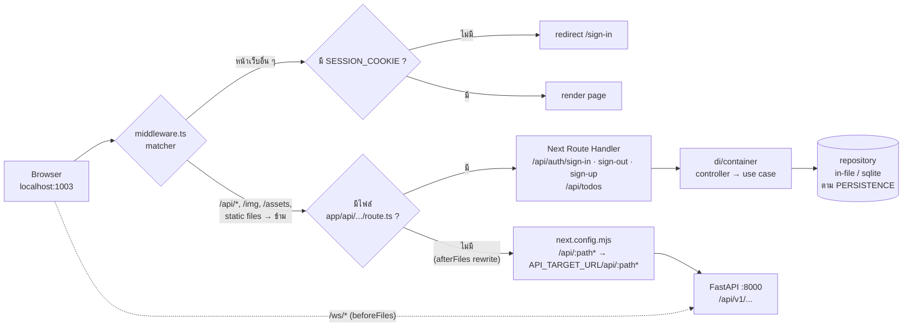
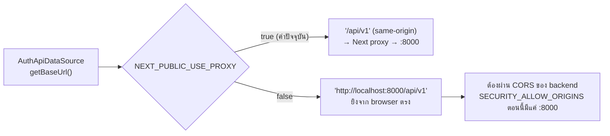
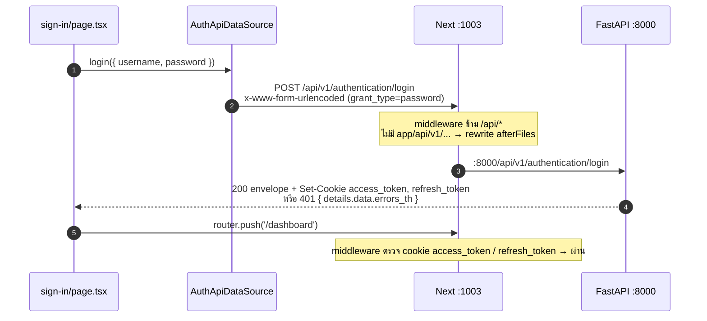
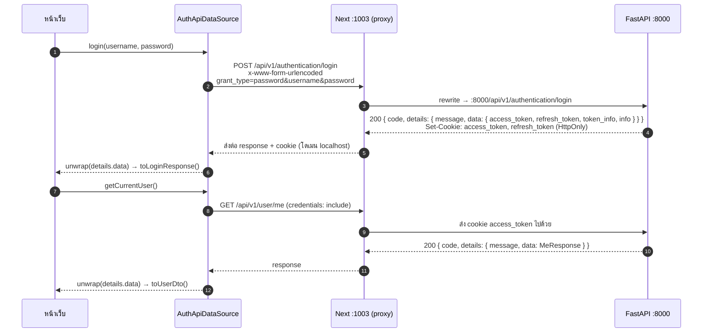
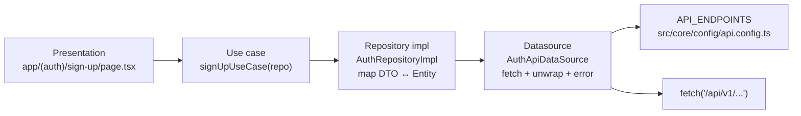

## API Flow

ทุก request จากหน้าเว็บ (`localhost:1003`) วิ่งเข้า Next.js ที่ `/api/...` ก่อน แล้ว Next.js ตัดสินว่าจะตอบเองด้วย route handler หรือ proxy ต่อไปที่ backend FastAPI (`fastapiiot`, `localhost:8000`)

ไฟล์ที่เกี่ยวข้อง:

| ไฟล์ | หน้าที่ |
|---|---|
| `next.config.mjs` | rewrite `/api/*` และ `/ws/*` ไป backend (`API_TARGET_URL`) |
| `middleware.ts` | ตรวจ `SESSION_COOKIE` สำหรับหน้าเว็บ (ข้าม `/api` และไฟล์ static) |
| `.env` | `API_TARGET_URL`, `NEXT_PUBLIC_USE_PROXY`, `NEXT_PUBLIC_API_TARGET_URL` |
| `src/core/config/environment.ts` | อ่านค่า env ฝั่ง client (`useProxy`, `apiTargetUrl`) |
| `src/core/config/api.config.ts` | `API_ENDPOINTS` (path ต่อจาก `/api/v1`) |
| `src/features/auth/data/datasources/auth.api.datasource.ts` | เรียก backend: base URL, form/json, unwrap envelope, error |
| `src/features/auth/data/repositories/auth.repository.impl.ts` | แปลง DTO ↔ Entity |
| `app/api/**/route.ts` | Route handler ใน Next (local) |

---

## 1. ภาพรวม: request เดินทางไปไหน



- `afterFiles` แปลว่า Next เช็คไฟล์ใน `app/api` ก่อน ถ้าไม่เจอจึงส่งต่อ backend
- `beforeFiles` (`/ws/*`) ส่งไป backend เสมอ
- middleware ข้าม `/api` ทั้งหมด จึงไม่ตรวจ session ให้ — backend ต้องตรวจสิทธิ์เอง
- `API_TARGET_URL` ถูกอ่านตอน dev server เริ่ม และ `NEXT_PUBLIC_*` ถูกฝังใน bundle — แก้ `.env` แล้วต้อง restart `npm run dev`

```js
// next.config.mjs
const API_TARGET = process.env.API_TARGET_URL || 'http://localhost:8000';

rewrites() {
  return {
    beforeFiles: [{ source: '/ws/:path*',  destination: `${API_TARGET}/ws/:path*` }],
    afterFiles:  [{ source: '/api/:path*', destination: `${API_TARGET}/api/:path*` }],
  };
}
```

---

## 2. เลือก base URL: proxy หรือยิงตรง



```ts
// auth.api.datasource.ts
const API_PREFIX = '/api/v1';

function getBaseUrl(): string {
  return environment.useProxy ? API_PREFIX : `${environment.apiTargetUrl}${API_PREFIX}`;
}
```

- ใช้ proxy (`true`) ดีกว่า: cookie อยู่ origin เดียวกับหน้าเว็บ และไม่ต้องตั้ง CORS
- ถ้าตั้ง `false` ต้องเพิ่ม `http://localhost:1003` ใน `SECURITY_ALLOW_ORIGINS` ของ backend

---

## 3. หน้า `/sign-in` → login ของ backend

```ts
// app/(auth)/sign-in/page.tsx
const authApi = new AuthApiDataSource();
await authApi.login({ username, password }); // POST /api/v1/authentication/login
router.push('/dashboard');
```

URL จริงคือ **`http://localhost:1003/api/v1/authentication/login`** → Next proxy → **`http://localhost:8000/api/v1/authentication/login`**



- ผิดพลาด → แสดง `errors_th` จาก backend เช่น "ข้อมูลเข้าสู่ระบบไม่ถูกต้อง"
- ช่อง "username" ส่งเป็น `username` ซึ่ง backend รับได้ทั้ง username และ email

ตรวจด้วย browser จริง (Edge, profile ใหม่): กรอกรหัสผิด → `POST /api/v1/authentication/login [application/x-www-form-urlencoded]` → `401` → แสดง "ข้อมูลเข้าสู่ระบบไม่ถูกต้อง" และอยู่หน้า `/sign-in`

### middleware ตรวจอะไร

```ts
// middleware.ts
const hasBackendSession =
  request.cookies.has('access_token') || request.cookies.has('refresh_token');
const hasLocalSession = request.cookies.has(SESSION_COOKIE); // 'auth_session'
if (!hasBackendSession && !hasLocalSession) redirect('/sign-in');
```

- ตรวจแค่ว่า**มี** cookie — ไม่ถอด token (เป็น JWE) backend ตรวจ token จริงทุกครั้งที่เรียก API
- นับ `refresh_token` ด้วย เพราะ access token อายุ 15 นาที แต่ cookie อยู่ได้ 1 วัน (`COOKIES_MAX_AGE_SECONDS=86400`)
- `SESSION_COOKIE` ยังรองรับ เพราะหน้า todos (`app/(home)`) และ `/api/todos` ยังใช้ session ของ Next

### Logout

```mermaid
sequenceDiagram
  participant UI as UserNav / UserMenu
  participant SA as signOutAction (server)
  participant BE as FastAPI :8000

  UI->>SA: signOutAction()
  SA->>BE: DELETE /api/v1/authentication/logout<br/>Cookie: access_token=…; refresh_token=…
  BE-->>SA: ยกเลิก session
  SA->>SA: ลบ cookie access_token, refresh_token, token_type, hub_device
  SA->>SA: ถ้ามี SESSION_COOKIE → sign-out ของ Next ด้วย
  SA-->>UI: redirect /sign-in
```

- server action เรียก backend ตรงที่ `API_TARGET_URL` (ไม่ผ่าน proxy) และส่ง cookie ของ browser ไปเอง
- ถ้า backend ล่มหรือเรียกไม่ได้ ยังลบ cookie และ logout ได้

### Route `/api/auth/sign-in` เดิม

ยังมีอยู่ที่ `app/api/auth/sign-in/route.ts` (Next ตอบเอง, in-file, ตั้ง `SESSION_COOKIE`) แต่หน้า `/sign-in` ไม่เรียกแล้ว

| | URL | Body | ข้อมูลผู้ใช้จาก | Cookie |
|---|---|---|---|---|
| หน้า `/sign-in` (ปัจจุบัน) | `POST localhost:1003/api/v1/authentication/login` → proxy → `:8000` | form-urlencoded `grant_type=password&username&password` | FastAPI (Postgres) | `access_token`, `refresh_token` |
| route เดิม (ไม่ได้ใช้จากหน้าเว็บ) | `POST localhost:1003/api/auth/sign-in` | JSON `{ username, password }` | in-file (Next) | `SESSION_COOKIE` |

---

## 4. Login กับ backend แล้วดึงข้อมูลผู้ใช้



- ยืนยันตัวตนด้วย **cookie** (`access_token`, `refresh_token` แบบ HttpOnly) ไม่ใช้ header `Authorization` เพราะ refresh จะยกเลิก access token เดิมทันที
- ไม่มี `grant_type=password` backend ตอบ **422**
- เรียก path แบบ**ไม่มี `/` ท้าย** เพราะ Next redirect 308 `/path/` → `/path` ก่อนถึง proxy (backend รับทั้งสองแบบ)

### รูปแบบ response ของ backend

```jsonc
// สำเร็จ
{ "code": 200, "method": "GET", "path": "/api/v1/user/me", "timestamp": "...",
  "details": { "message": "Request processed successfully", "data": { /* payload */ } } }

// ผิดพลาด
{ "code": 401, "method": "POST", "path": "/api/v1/authentication/login", "timestamp": "...",
  "details": { "message": "Unauthorized access",
               "data": { "errors": "Invalid credentials for login.",
                         "errors_th": "ข้อมูลเข้าสู่ระบบไม่ถูกต้อง" } } }
```

`handleResponse()` ใน datasource:
- สำเร็จ → คืน `details.data` (ถ้าไม่มี envelope คืน body ตรง ๆ — กันไว้เฉย ๆ ทุก endpoint ที่เจอมี envelope)
- ผิดพลาด → ใช้ข้อความ `errors_th` → `errors` → `details.message` ตามลำดับ

> OpenAPI (`/openapi.json`) แสดงแค่ schema ข้างใน เช่น `LoginResponse` แต่ response จริงถูกห่อด้วย envelope เสมอ

### ตัวอย่าง response จริงของ login

```jsonc
// POST localhost:8000/api/v1/authentication/login  (token ตัดออก)
{
  "code": 200,
  "method": "POST",
  "path": "/api/v1/authentication/login",
  "timestamp": "2026-11-21T04:12:36.781432Z",
  "details": {
    "message": "User logged in successfully",
    "data": {
      "access_token": "eyJhbGciOiJFQ0RILUVTK0EyNTZLVyIs…",   // JWE (เข้ารหัส) ไม่ใช่ JWT ธรรมดา
      "refresh_token": "eyJhbGciOiJFQ0RILUVTK0EyNTZLVyIs…",
      "token_info": {
        "created_at": "2026-11-21T01:12:36.743090-03:00",
        "expires_at": "2026-11-21T01:27:36.743090-03:00",  // access token อายุ 15 นาที
        "claims": {
          "iss": "fastapi-clean-architecture-ddd-template",
          "sub": "10000000004",          // user id
          "aud": "fastapi-clean-architecture-ddd-template",
          "iat": 1795234356, "nbf": 1795234356, "exp": 1795235256,
          "jti": "e342d6df-…",
          "grant_id": "admin@example.com",
          "scope": "admin"               // = role
        }
      },
      "info": {
        "first_name": "admin", "last_name": "admin", "preferred_name": "admin",
        "gender": "other", "birthdate": "1990-01-01",
        "email": "admin@example.com", "phone": "+555472664275",
        "role": "admin",
        "created_at": "2026-09-29T05:25:56.449029+00:00"
      }
    }
  }
}
```

`toLoginResponse()` แปลงเป็น `LoginResponseDto`:

| field ใน response | → `LoginResponseDto` |
|---|---|
| `access_token` | `accessToken` |
| `refresh_token` | `refreshToken` |
| — | `tokenType = 'bearer'` |
| `token_info.expires_at` − ตอนนี้ | `expiresIn` (วินาที, ~900) |
| `info` | `user` |

- access token อายุ **15 นาที** (`exp − iat = 900`) ต้อง refresh ด้วย `PATCH /api/v1/authentication/refresh` ก่อนหมดอายุ
- token เป็น **JWE** (`alg: ECDH-ES+A256KW`, `enc: A256GCM`) ฝั่ง frontend ถอดอ่าน claims เองไม่ได้ ให้ใช้ `token_info.claims` / `info` จาก response แทน
- `info` ไม่มี `id` — ถ้าต้องการ id ให้ใช้ `token_info.claims.sub` หรือเรียก `GET /api/v1/user/me`

---

## 5. ชั้นของโค้ดใน feature (DDD)



- **Datasource** รู้จักรูปแบบ HTTP ของ backend: path, method, form/json, envelope `details.data`, ข้อความ error `errors_th`
- **Repository** แปลง `UserResponseDto` เป็น entity `User` ให้ use case ใช้ โดยไม่รู้เรื่อง HTTP
- **Use case** เรียกผ่าน interface `IAuthRepository`

---

## 6. สถานะ endpoint

| ใช้ทำอะไร | เรียก | ไปที่ | สถานะ |
|---|---|---|---|
| Login (หน้า `/sign-in`) | `POST /api/v1/authentication/login` | FastAPI | ✅ มีใน backend (ดูหัวข้อ 3) |
| Logout (`signOutAction`) | `DELETE /api/v1/authentication/logout` | FastAPI | ✅ มีใน backend |
| Todos demo (`app/(home)`) | `/api/auth/sign-in`, `/api/todos` | Next route → in-file | local — ใช้ `SESSION_COOKIE` |
| สมัครสมาชิก (หน้า `/sign-up`) | `POST /api/v1/authentication/sign-up` | FastAPI | ✅ มีใน backend |
| Logout | `DELETE /api/v1/authentication/logout` | FastAPI | ✅ มีใน backend |
| Refresh token | `PATCH /api/v1/authentication/refresh` | FastAPI | ✅ มีใน backend |
| ลืม / ตั้งรหัสผ่านใหม่ | `POST /api/v1/authentication/forgot-password`, `reset-password` | FastAPI | ✅ มีใน backend |
| ข้อมูลผู้ใช้ปัจจุบัน | `GET /api/v1/user/me` | FastAPI | ✅ มีใน backend |
| สร้างผู้ใช้ | `POST /api/v1/user` | FastAPI | ✅ มีใน backend |
| รายชื่อ / แก้ไข / ลบผู้ใช้ | `/api/users`, `/api/v1/user/list` | FastAPI | ❌ 404 ไม่มี |
| Roles / Permissions | `/api/roles`, `/api/v1/roles` | FastAPI | ❌ 404 ไม่มี |
| Alarms | `/api/alarms` | FastAPI | ❌ 404 ไม่มี |

รายการ endpoint ทั้งหมดของ backend ดูได้ที่ `http://localhost:8000/openapi.json` หรือ Postman collection
`c:\github\fastapiiot\docs\postman\FastAPI Clean Architecture and DDD Template.postman_collection.json`

---

## 7. ค่าใน `.env`

```env
API_TARGET_URL=http://localhost:8000              # ปลายทางของ proxy (server)
NEXT_PUBLIC_API_TARGET_URL=http://localhost:8000  # ใช้เมื่อ USE_PROXY=false (browser)
NEXT_PUBLIC_USE_PROXY=true                        # true = เรียกผ่าน /api/v1 same-origin
NEXT_PUBLIC_API_PRIMARY=http://localhost:8000     # ยังไม่ถูกใช้ (fallback ยังไม่ได้ต่อ)
```

ค่าส่วนตัวให้ใส่ใน `.env.local` (git-ignore และ override `.env`)

---

## 8. ยังไม่เชื่อมกัน

- **Refresh token อัตโนมัติยังไม่มี**: access token หมดใน 15 นาที แล้ว API จะตอบ 401 ต้องเพิ่มการเรียก `PATCH /api/v1/authentication/refresh` เมื่อได้ 401 แล้วลองใหม่
- **หน้า todos demo** (`app/(home)`, `/api/todos`) ยังใช้ `SESSION_COOKIE` ของ Next — ผู้ใช้ที่ login ผ่าน backend จะไม่มี session นี้
- **e2e test** `tests/e2e/app/(auth)/sign-in.test.ts` ยังอ้าง `data-testid` และ server action แบบเดิม (ไม่ตรงกับหน้าปัจจุบันตั้งแต่ก่อนเปลี่ยน)
- หน้า user list / edit / profile / role-list เรียก `/api/users`, `/api/roles` ซึ่ง backend ยังไม่มี
