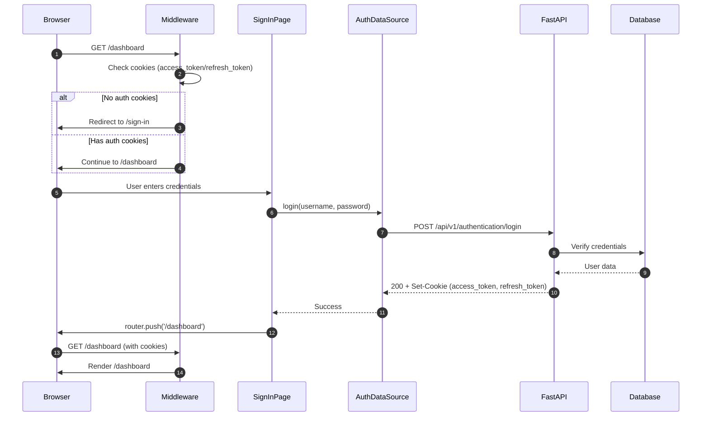
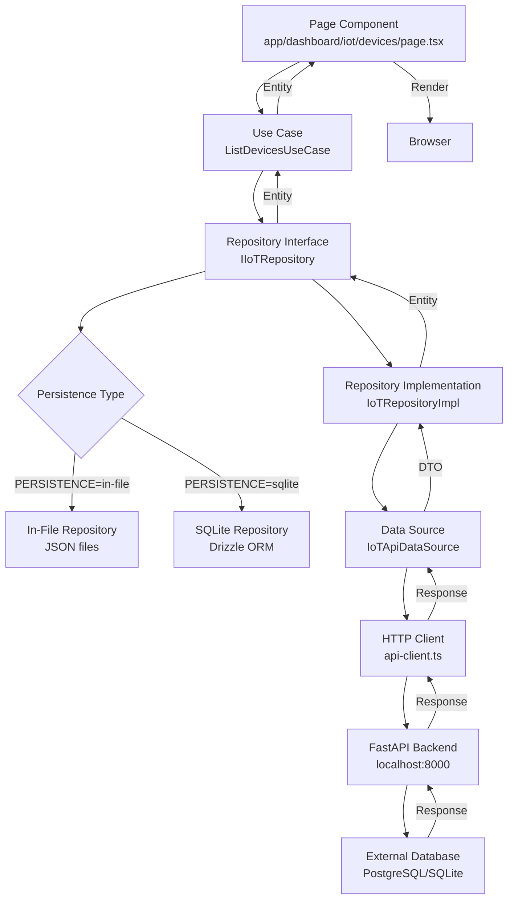
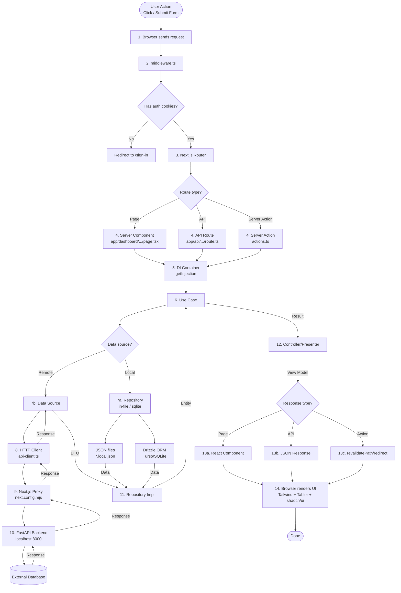
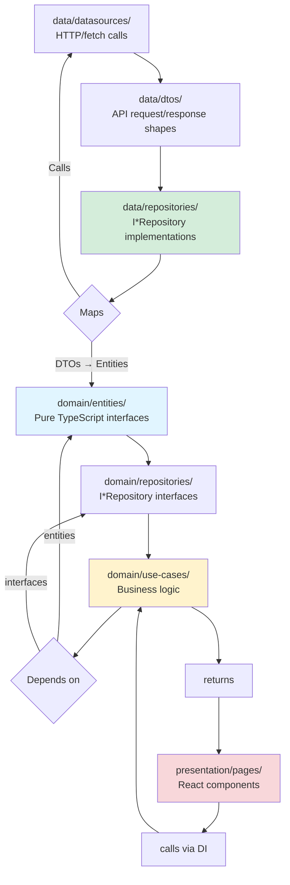

# เอกสารสถาปัตยกรรม React + Next.js + DDD
## IoT Monitoring Web Application

---

## บทนำ

เอกสารนี้อธิบายสถาปัตยกรรมของระบบ **IoT Monitoring Web Application** ที่พัฒนาด้วย **React 18 + Next.js 14** โดยใช้หลักการ **Domain-Driven Design (DDD)** และ **Clean Architecture**

โปรเจกต์นี้เป็นการ migrate จาก Angular 21 มาเป็น React/Next.js โดยรักษาโครงสร้างแบบ Clean Architecture และเพิ่มประสิทธิภาพด้วย Server Components, Server Actions และ App Router ของ Next.js

### วัตถุประสงค์

1. **แยกชั้นการทำงาน (Separation of Concerns)**: แยก Business Logic, UI, และ Infrastructure ออกจากกันอย่างชัดเจน
2. **ทดสอบง่าย (Testability)**: สามารถเขียน Unit Test และ E2E Test ได้ครอบคลุม
3. **บำรุงรักษาง่าย (Maintainability)**: โค้ดมีโครงสร้างชัดเจน ค้นหาและแก้ไขได้รวดเร็ว
4. **ขยายตัวได้ (Scalability)**: เพิ่ม Feature ใหม่ได้โดยไม่กระทบระบบเดิม
5. **ยืดหยุ่น (Flexibility)**: สลับ Database, API Backend หรือ UI Framework ได้ง่าย

### กลุ่มเป้าหมาย

เอกสารนี้เหมาะสำหรับ:
- **Full-stack Developers** ที่ต้องการทำความเข้าใจโครงสร้างโปรเจกต์
- **Frontend Developers** ที่จะพัฒนา UI และ Feature ใหม่
- **Backend Developers** ที่ต้องเชื่อมต่อ API กับ Frontend
- **DevOps Engineers** ที่ต้อง deploy และ maintain ระบบ
- **Architects** ที่ต้องการศึกษาหรือปรับปรุงสถาปัตยกรรม

### ความรู้พื้นฐานที่ต้องมี

- TypeScript, React Hooks, Next.js App Router
- Clean Architecture, DDD, Dependency Injection
- RESTful API, HTTP Client (fetch)
- Zod (Schema Validation)
- Git, Docker

---

## นิยามศัพท์ (Glossary)

| ศัพท์ | ความหมาย |
|------|----------|
| **Clean Architecture** | สถาปัตยกรรมที่แยกชั้นการทำงานตามหลัก Dependency Rule (ชั้นในไม่รู้จักชั้นนอก) |
| **DDD (Domain-Driven Design)** | แนวทางออกแบบซอฟต์แวร์ที่มุ่งเน้นที่ Business Domain เป็นหลัก |
| **Entity** | โมเดลข้อมูลหลัก (Domain Model) ที่มี identity เช่น User, Customer, Device |
| **Use Case** | กรณีการใช้งานเฉพาะ (Business Logic) เช่น CreateCustomer, GetDevice |
| **Repository** | Interface สำหรับการเข้าถึงข้อมูล (Data Access Layer) |
| **Data Source** | ตัวเชื่อมต่อกับแหล่งข้อมูลจริง เช่น REST API, Database |
| **DTO (Data Transfer Object)** | โครงสร้างข้อมูลที่ใช้ส่งต่อระหว่างชั้น |
| **DI (Dependency Injection)** | รูปแบบการส่งมอบ dependencies ให้กับ class/function |
| **BFF (Backend for Frontend)** | Adapter Layer ระหว่าง Frontend และ Backend |
| **Server Component** | React Component ที่ทำงานฝั่ง Server (Next.js) |
| **Server Action** | Function ที่ทำงานฝั่ง Server และเรียกจาก Client Component |

---

## เนื้อหาโดยย่อ

โปรเจกต์นี้ประกอบด้วย:

1. **26 Feature Modules** (IoT, Monitoring, Settings, Customer, Job Card, Reports, etc.)
2. **Clean Architecture** แยก 5 ชั้น: Presentation, Interface Adapters, Application, Domain, Infrastructure
3. **Dual Persistence**: รองรับทั้ง SQLite (Turso) และ in-file JSON
4. **Multi-Backend**: เชื่อมต่อ FastAPI (port 8000) ผ่าน Next.js proxy
5. **Role-Based Access Control (RBAC)**: Admin และ User มีสิทธิ์ต่างกัน
6. **i18n**: รองรับ 10 ภาษา (EN, TH, ZH, JA, KO, VI, MY, MS, KM, LO)
7. **Dark Mode**: ใช้ Tabler UI + Tailwind CSS + shadcn/ui
8. **Testing**: Vitest (Unit), Playwright (E2E), ESLint Boundaries

**ประโยชน์หลัก**:
- **แยกชั้นชัดเจน**: เปลี่ยน Database หรือ UI ได้โดยไม่กระทบ Business Logic
- **ทดสอบง่าย**: Mock Repository/DataSource ได้ง่าย
- **บำรุงรักษาง่าย**: หา Use Case หรือ Feature ได้ทันที
- **ทีมงานใหญ่**: คนละ Feature ไม่ชนกัน

---

## โครงสร้างโฟลเดอร์ (Folder Structure)

```
react-nextjs-ddd/
├── app/                                # Presentation Layer (Next.js App Router)
│   ├── _components/                    # Shared UI Components
│   │   ├── ui/                         # shadcn/ui (Button, Card, Input, etc.)
│   │   ├── layout/                     # App Shell (Sidebar, Header, ThemeToggle)
│   │   │   ├── app-layout.tsx
│   │   │   ├── sidebar.tsx
│   │   │   ├── header.tsx
│   │   │   ├── theme-toggle.tsx
│   │   │   └── user-nav.tsx
│   │   ├── shared/                     # ApiUnavailable, Pagination
│   │   ├── auth/                       # ThemeBuilder (demo page)
│   │   └── utils.ts                    # cn() utility
│   │
│   ├── (auth)/                         # Public Routes (ไม่ต้อง login)
│   │   ├── sign-in/page.tsx
│   │   └── sign-up/page.tsx
│   │
│   ├── (dashboard)/                    # Protected Routes (ต้อง login)
│   │   ├── layout.tsx                  # AppLayout wrapper
│   │   ├── dashboard/page.tsx
│   │   ├── customers/page.tsx
│   │   ├── iot/
│   │   │   ├── devices/page.tsx        # Device List
│   │   │   ├── devices/[id]/page.tsx   # Device Detail
│   │   │   ├── map/page.tsx
│   │   │   ├── reports/page.tsx
│   │   │   └── settings/page.tsx
│   │   ├── monitoring/
│   │   │   ├── layout.tsx              # Tabs layout
│   │   │   ├── smartmonitor/page.tsx
│   │   │   ├── smarthome/page.tsx
│   │   │   └── ...
│   │   ├── settings/
│   │   │   ├── hardware/page.tsx
│   │   │   ├── locations/page.tsx
│   │   │   ├── schedule/page.tsx
│   │   │   └── ...
│   │   └── ... (25+ features)
│   │
│   ├── api/                            # REST API Routes (Local)
│   │   ├── auth/
│   │   │   ├── sign-in/route.ts
│   │   │   ├── sign-out/route.ts
│   │   │   └── sign-up/route.ts
│   │   └── todos/
│   │       ├── route.ts
│   │       ├── [id]/route.ts
│   │       └── bulk/route.ts
│   │
│   ├── layout.tsx                      # Root Layout (fonts, theme, toasts)
│   ├── globals.scss                    # Tabler + Tailwind + shadcn/ui
│   ├── error.tsx                       # Global Error Boundary (500)
│   ├── not-found.tsx                   # 404 Page
│   └── unauthorized/page.tsx           # 403 Page
│
├── src/                                # Clean Architecture Layers
│   ├── core/                           # Core Infrastructure (Shared)
│   │   ├── config/
│   │   │   ├── app.config.ts           # APP_CONFIG, API_CONFIG, AUTH_CONFIG
│   │   │   ├── environment.ts          # Environment variables
│   │   │   ├── nav-menu.config.ts      # Sidebar menu structure
│   │   │   └── route-permissions.config.ts  # RBAC routes
│   │   ├── constants/
│   │   │   ├── device-type.constant.ts
│   │   │   ├── job-status.constant.ts
│   │   │   └── roles.constant.ts
│   │   ├── http/
│   │   │   └── api-client.ts           # Unified HTTP client
│   │   ├── ui/
│   │   │   ├── pagination.tsx
│   │   │   ├── use-async.ts
│   │   │   └── api-unavailable.tsx
│   │   ├── services/
│   │   │   ├── logger.service.ts
│   │   │   ├── permission.service.ts
│   │   │   ├── seo.service.ts
│   │   │   └── theme.service.ts
│   │   ├── types/
│   │   │   ├── api-response.type.ts
│   │   │   ├── common.types.ts
│   │   │   └── pagination.type.ts
│   │   └── utils/
│   │       ├── formatters.ts
│   │       ├── helpers.ts
│   │       └── validators.ts
│   │
│   ├── features/                       # Feature Modules (Vertical Slices)
│   │   │
│   │   ├── auth/                       # Authentication & Authorization
│   │   │   ├── domain/
│   │   │   │   ├── entities/
│   │   │   │   ├── repositories/
│   │   │   │   └── use-cases/
│   │   │   ├── data/
│   │   │   │   ├── datasources/
│   │   │   │   ├── dtos/
│   │   │   │   └── repositories/
│   │   │   └── presentation/pages/
│   │   │
│   │   ├── customer/                   # Customer Management
│   │   ├── dashboard/                  # Main Dashboard
│   │   ├── iot/                        # IoT Device Management
│   │   ├── monitoring/                 # IoT Monitoring Dashboards
│   │   ├── settings/                   # System Settings
│   │   ├── job-card/                   # Job Management
│   │   ├── report/                     # Reports
│   │   ├── mqtt/                       # MQTT Flow Editor
│   │   ├── ai-chatbot/                 # AI Chatbot
│   │   ├── ai-analytics/               # AI Analytics
│   │   ├── inventory/                  # Inventory Management
│   │   ├── payment/                    # Payment Management
│   │   ├── quotation/                  # Quotation Management
│   │   ├── purchase-order/             # Purchase Order Management
│   │   ├── document/                   # Document Management
│   │   ├── email/                      # Email Templates
│   │   ├── batch/                      # Batch Jobs
│   │   ├── alarm/                      # Alarm Management
│   │   ├── user/                       # User Management
│   │   ├── system/                     # System Health
│   │   ├── websocket/                  # WebSocket Support
│   │   ├── wos/                        # Web Order System
│   │   ├── orders/                     # Order Data
│   │   └── errors/                     # Error Pages
│   │
│   ├── entities/                       # Shared Domain Entities
│   │   ├── models/
│   │   │   ├── user.ts
│   │   │   ├── session.ts
│   │   │   ├── todo.ts
│   │   │   ├── customer.ts
│   │   │   ├── device.ts
│   │   │   ├── hardware.ts
│   │   │   ├── location.ts
│   │   │   └── ...
│   │   └── errors/
│   │       ├── auth.ts
│   │       └── common.ts
│   │
│   ├── application/                    # Shared Application Layer
│   │   ├── repositories/               # Repository Interfaces (Ports)
│   │   │   ├── customers.repository.interface.ts
│   │   │   ├── devices.repository.interface.ts
│   │   │   ├── todos.repository.interface.ts
│   │   │   └── ...
│   │   ├── services/                   # Service Interfaces
│   │   │   ├── authentication.service.interface.ts
│   │   │   └── transaction-manager.service.interface.ts
│   │   └── use-cases/                  # Shared Use Cases
│   │       ├── auth/
│   │       ├── todos/
│   │       └── ...
│   │
│   ├── infrastructure/                 # Infrastructure Implementations
│   │   ├── repositories/
│   │   │   ├── *.repository.in-file.ts   # JSON file storage
│   │   │   ├── *.repository.sqlite.ts    # SQLite/Turso (Drizzle ORM)
│   │   │   └── *.repository.mock.ts      # Mock for testing
│   │   └── services/
│   │       ├── authentication.service.*.ts
│   │       └── transaction-manager.service.*.ts
│   │
│   └── interface-adapters/             # Interface Adapters
│       ├── api/                        # REST API Adapters
│       │   ├── auth/
│       │   └── todos/
│       ├── bff/                        # Backend-for-Frontend Adapters
│       │   ├── auth/
│       │   ├── customers/
│       │   ├── dashboard/
│       │   ├── iot/
│       │   └── ...
│       └── e2e/                        # E2E Test Adapters
│
├── di/                                 # Dependency Injection Container
│   ├── container.ts                    # IoC Container setup
│   ├── types.ts                        # DI_SYMBOLS (68 symbols)
│   ├── persistence.ts                  # in-file / sqlite switch
│   └── modules/                        # DI Modules
│       ├── authentication.module.ts
│       ├── database.module.ts
│       ├── todos.module.ts
│       └── users.module.ts
│
├── public/                             # Static Assets
│   ├── assets/
│   │   ├── appcss/                     # Inter font
│   │   ├── flags/                      # Country flags
│   │   ├── img/                        # Images
│   │   ├── users/                      # User avatars
│   │   └── tabler/                     # Tabler UI assets
│   │       ├── dist/css/               # CSS libraries
│   │       ├── dist/fonts/             # Geist Sans font
│   │       ├── dist/libs/              # typed.js
│   │       └── scss/                   # SCSS customization
│   └── i18n/                           # Internationalization (10 languages)
│       ├── en.json
│       ├── th.json
│       ├── zh.json
│       ├── ja.json
│       ├── ko.json
│       ├── vi.json
│       ├── my.json
│       ├── ms.json
│       ├── km.json
│       └── lo.json
│
├── drizzle/                            # Database Schema & Migrations
│   ├── schema.ts
│   └── migrations/
│
├── tests/                              # Test Suite
│   ├── e2e/                            # Playwright E2E tests
│   │   ├── auth.setup.ts
│   │   ├── sign-in.spec.ts
│   │   └── todos.spec.ts
│   └── unit/                           # Vitest unit tests (colocated)
│
├── docs/                               # Documentation
│   ├── README.md
│   ├── architecture-guide.md
│   ├── architecture-react-nextjs-ddd.md  # This file
│   ├── module-map.md
│   ├── migration-report.md
│   ├── theme-guide.md
│   ├── plan.md                         # Migration plan
│   └── apiflow.md                      # API flow documentation
│
├── middleware.ts                        # Auth Middleware
├── config.ts                           # App constants (SESSION_COOKIE, etc.)
├── drizzle.config.ts                   # Drizzle ORM config
├── next.config.mjs                     # Next.js config (proxy, SCSS)
├── tailwind.config.ts                  # Tailwind CSS config
├── tsconfig.json                       # TypeScript config
├── vitest.config.ts                    # Vitest config
├── playwright.config.base.ts           # Playwright config
├── .eslintrc.json                      # ESLint + Boundaries rules
├── .prettierrc                         # Prettier config
├── .env                                # Environment variables
├── Dockerfile                          # Multi-stage Docker build
├── docker-compose.yml                  # Docker Compose (dev + prod)
└── package.json
```

---

## หลักการทำงาน (Concept)

### Clean Architecture Layers

โปรเจกต์นี้แบ่งเป็น 5 ชั้นหลัก ตามหลัก **Dependency Rule** (ชั้นในไม่รู้จักชั้นนอก):

```
┌──────────────────────────────────────────────┐
│  1. PRESENTATION LAYER (app/)               │
│     • Pages (Server/Client Components)       │
│     • Layouts, UI Components                 │
│     • Server Actions                         │
│     • API Routes                             │
└──────────────────┬───────────────────────────┘
                   │ depends on
                   ▼
┌──────────────────────────────────────────────┐
│  2. INTERFACE ADAPTERS (interface-adapters/) │
│     • Controllers (API/BFF)                  │
│     • Presenters (View Models)               │
│     • Contracts (Gateway interfaces)         │
└──────────────────┬───────────────────────────┘
                   │ depends on
                   ▼
┌──────────────────────────────────────────────┐
│  3. APPLICATION LAYER (application/)         │
│     • Use Cases (Business Logic)             │
│     • Repository Interfaces (Ports)          │
│     • Service Interfaces                     │
└──────────────────┬───────────────────────────┘
                   │ depends on
                   ▼
┌──────────────────────────────────────────────┐
│  4. DOMAIN LAYER (entities/)                 │
│     • Entities (Zod Schemas)                 │
│     • Domain Errors                          │
│     • Value Objects                          │
└──────────────────────────────────────────────┘

┌──────────────────────────────────────────────┐
│  5. INFRASTRUCTURE LAYER (infrastructure/)   │
│     • Repository Implementations             │
│     • Service Implementations                │
│     • Data Sources (API, Database)           │
│     ← Implements interfaces from Application │
└──────────────────────────────────────────────┘

┌──────────────────────────────────────────────┐
│  DEPENDENCY INJECTION (di/)                  │
│     • Wires all layers together              │
│     • Can import everything                  │
└──────────────────────────────────────────────┘
```

### Feature Module Structure

แต่ละ Feature Module มีโครงสร้างแบบ **Vertical Slice**:

```
features/{feature}/
├── domain/                     # Domain Layer (Pure TypeScript)
│   ├── entities/               # Entities (Zod schemas)
│   │   └── {name}.entity.ts
│   ├── repositories/           # Repository Interfaces
│   │   └── {name}.repository.ts
│   └── use-cases/              # Business Logic
│       ├── create-{name}.use-case.ts
│       ├── get-{name}.use-case.ts
│       ├── list-{names}.use-case.ts
│       └── ...
│
├── data/                       # Data Layer (Implementation)
│   ├── datasources/            # API Data Sources
│   │   └── {name}.api.datasource.ts
│   ├── dtos/                   # Request/Response DTOs
│   │   ├── {name}-response.dto.ts
│   │   └── {name}-request.dto.ts
│   └── repositories/           # Repository Implementations
│       └── {name}.repository.impl.ts
│
├── presentation/               # Presentation Layer
│   ├── pages/                  # Page Components
│   │   ├── {page-name}.tsx
│   │   └── ...
│   ├── components/             # Feature-specific Components
│   └── {feature}.container.ts  # DI Container (optional)
│
└── index.ts                    # Barrel export
```

**ข้อดี**:
- แต่ละ Feature เป็นอิสระ ทำงานแยกกันได้
- หา Use Case หรือ Component ของ Feature ใดได้ทันที
- ทีมงานหลายคนทำงานพร้อมกันได้ไม่ชนกัน

---

## Workflow และ Dataflow

### 1. Authentication Flow



**อธิบาย**:
1. User เข้า `/dashboard` โดยไม่ได้ login → middleware ตรวจพบไม่มี cookie → redirect ไป `/sign-in`
2. User กรอก username/password → เรียก `AuthDataSource.login()`
3. DataSource ส่ง POST request ไป FastAPI (`/api/v1/authentication/login`)
4. FastAPI ตรวจสอบข้อมูลกับ Database และคืน JWT tokens ผ่าน `Set-Cookie`
5. Browser เก็บ `access_token` และ `refresh_token` ใน cookies
6. User ถูก redirect ไป `/dashboard` → middleware ตรวจพบ cookies → อนุญาตเข้าได้

### 2. Data Fetching Flow (Feature Module)



**อธิบาย**:
1. **Page Component** เรียก Use Case ผ่าน DI Container
2. **Use Case** เรียก Repository Interface (ไม่รู้ว่า data มาจากไหน)
3. **Repository Implementation** ตัดสินใจว่าจะใช้:
   - **In-File Repository**: อ่าน/เขียนไฟล์ JSON (`*.local.json`)
   - **SQLite Repository**: Query ผ่าน Drizzle ORM → Turso/SQLite
   - **API Data Source**: เรียก FastAPI ผ่าน HTTP Client
4. **Data Source** ใช้ `api-client.ts` ส่ง request ไป FastAPI
5. **FastAPI** query database จริง (PostgreSQL/SQLite) และคืน response
6. Data ไหลกลับผ่าน DTO → Entity → Use Case → Page Component
7. **Browser** แสดง UI จากข้อมูลที่ได้

### 3. Request Lifecycle (Complete)



**อธิบาย แต่ละขั้นตอน**:

1. **User Action**: User คลิกลิงก์, กดปุ่ม, หรือส่งฟอร์ม
2. **middleware.ts**: ตรวจสอบ cookies (`access_token` หรือ `refresh_token`)
   - ไม่มี → redirect ไป `/sign-in`
   - มี → ผ่านไปขั้นต่อไป
3. **Next.js Router**: จับคู่ route กับไฟล์ใน `app/`
4. **เลือกประเภท Route**:
   - **Page**: Server Component (`page.tsx`) → fetch data แล้ว render HTML
   - **API Route**: Route handler (`route.ts`) → คืน JSON
   - **Server Action**: Function ที่รันฝั่ง Server → เรียกจาก Client Component
5. **DI Container**: `getInjection('ISomeUseCase')` ดึง Use Case จาก IoC Container
6. **Use Case**: รัน Business Logic, เรียก Repository Interface
7. **เลือกแหล่งข้อมูล**:
   - **Local**: Repository Implementation (in-file หรือ sqlite)
     - **in-file**: อ่าน/เขียนไฟล์ JSON (`in-file-*.local.json`)
     - **sqlite**: Query ผ่าน Drizzle ORM → Turso/LibSQL
   - **Remote**: Data Source เรียก API ภายนอก
8. **HTTP Client** (`api-client.ts`): ส่ง request (GET/POST/PUT/DELETE)
9. **Next.js Proxy** (`next.config.mjs`):
   - `/api/*` → `http://localhost:8000/api/*`
   - `/backend/*` → `http://localhost:8000/*` (สำหรับ `/iot`, `/llm`)
10. **FastAPI Backend** (port 8000): รับ request, query database จริง
11. **Repository Implementation**: แปลง DTO → Entity
12. **Controller/Presenter**: แปลง Entity → View Model
13. **Response Type**:
    - **Page**: คืน React Component (HTML)
    - **API**: คืน JSON
    - **Action**: `revalidatePath()` หรือ `redirect()`
14. **Browser**: render UI ด้วย Tailwind CSS + Tabler UI + shadcn/ui

### 4. Feature Module Internal Flow



**หลักการ**:
- **domain/** ไม่ import อะไรจากภายนอก (Pure TypeScript)
- **data/** ขึ้นกับ **domain/** (implements interfaces)
- **presentation/** ขึ้นกับ **domain/** (เรียก Use Cases)

---

## การติดตั้งและการใช้งาน

### ขั้นตอนการติดตั้ง

#### 1. Prerequisites

- **Node.js** >= 22.0
- **npm** >= 10.0
- **Go Backend (fastapiiot)** running on port 8000 (optional)
- **Docker** (optional, สำหรับ production)

#### 2. Clone Repository

```bash
git clone <repository-url>
cd react-nextjs-ddd
```

#### 3. Install Dependencies

```bash
npm install
```

#### 4. Environment Variables

สร้างไฟล์ `.env` (หรือ copy จาก `.env.example`):

```env
# API Proxy (like Angular proxy.conf.json)
API_TARGET_URL=http://localhost:8000
NEXT_PUBLIC_API_TARGET_URL=http://localhost:8000
NEXT_PUBLIC_USE_PROXY=true
NEXT_PUBLIC_API_PRIMARY=http://localhost:8000

# Persistence Mode (in-file | sqlite)
PERSISTENCE=in-file

# Database (SQLite/Turso)
DATABASE_URL=file:sqlite.local.db
DATABASE_AUTH_TOKEN=local-dev-placeholder

# In-File Storage
IN_FILE_USERS_FILE=in-file-users.local.json
IN_FILE_TODOS_FILE=in-file-todos.local.json

# AI / Chatbot (optional)
NEXT_PUBLIC_OLLAMA_URL=http://localhost:11434
NEXT_PUBLIC_OLLAMA_MODEL=llama3
NEXT_PUBLIC_CHATBOT_ENABLED=true

# Logging
NEXT_PUBLIC_LOG_LEVEL=debug
NEXT_PUBLIC_DEMO=false
```

**คำอธิบาย**:
- `API_TARGET_URL`: URL ของ Backend API (FastAPI)
- `NEXT_PUBLIC_USE_PROXY`: ใช้ Next.js proxy (`true`) หรือเรียก API ตรงจาก Browser (`false`)
- `PERSISTENCE`: โหมดเก็บข้อมูล (`in-file` = JSON files, `sqlite` = Turso/LibSQL)

#### 5. Run Development Server

```bash
# Default (in-file persistence)
npm run dev
# → http://localhost:3000

# With SQLite persistence
npm run dev:sqlite

# With in-file persistence (explicit)
npm run dev:in-file
```

#### 6. ทดสอบการเชื่อมต่อ Backend

เปิด browser ไปที่ `http://localhost:3000/sign-in`
- **กรณีมี Backend** (FastAPI running): สามารถ login ด้วย username/password จริงได้
- **กรณีไม่มี Backend**: หน้าจะแสดงข้อความ "Cannot connect to backend"

---

## คู่มือการทดสอบ

### รันคำสั่งทดสอบ

```bash
# Static Analysis (Format + Types + Lint)
npm run test:static

# Unit Tests (Vitest)
npm run test:unit

# Unit Tests with Watch Mode
npm run test:unit:watch

# Unit Tests with Coverage
npm run test:unit:coverage

# E2E Tests (Playwright)
npm run test:e2e

# Full Test Suite (static + unit + e2e)
npm run test:full

# Individual Checks
npm run test:format     # Prettier check
npm run test:types      # TypeScript check
npm run test:lint       # ESLint check
```

### Test Structure

```
tests/
├── e2e/                        # Playwright E2E tests
│   ├── auth.setup.ts           # Auth setup
│   ├── sign-in.spec.ts
│   └── todos.spec.ts

# Unit tests colocated with source files:
src/
├── features/auth/.../sign-in.use-case.spec.ts
├── interface-adapters/bff/.../*.test.ts
├── core/utils/formatters.spec.ts
└── ...
```

### Architecture Boundary Testing

ESLint plugin `eslint-plugin-boundaries` บังคับ Dependency Rules:

```
✅ Allowed imports:
- web → entities, di
- api/bff/e2e → entities, use-cases, repository-interfaces, service-interfaces
- use-cases → entities, repository-interfaces, service-interfaces
- infrastructure → repository-interfaces, service-interfaces, entities
- entities → entities (self only)

❌ Not allowed:
- entities → anything else
- use-cases → infrastructure
- infrastructure → web
```

ถ้า import ผิด → ESLint จะ error ทันที

### Check List Test

#### การทดสอบหน้า Page

| หัวข้อ | วิธีทดสอบ | ผลที่คาดหวัง |
|--------|-----------|--------------|
| **Page Load** | เปิดหน้าใน browser (Edge profile ใหม่) | หน้าโหลดได้, ไม่มี console error |
| **Hydration** | ตรวจสอบ console | ไม่มี "Hydration error" |
| **Responsive** | เปลี่ยนขนาดหน้าจอ 400px, 768px, 1024px | หน้าไม่ล้น, scroll ได้ตามปกติ |
| **Dark Mode** | คลิก Theme Toggle | สลับ dark/light mode ได้ไม่มี layout shift |
| **i18n** | สลับภาษาใน Sidebar | ข้อความเปลี่ยนถูกต้อง, ไม่มี key ขาดหาย |
| **Auth** | Logout แล้วเข้าหน้า protected | ถูก redirect ไป `/sign-in` |

#### การทดสอบ Feature Module

| หัวข้อ | วิธีทดสอบ | ผลที่คาดหวัง |
|--------|-----------|--------------|
| **Use Case** | Run unit test | Test ผ่าน 100% |
| **Repository** | Mock data source | Repository คืนค่า Entity ถูกต้อง |
| **Data Source** | ใช้ Mock Server (MSW) | Data Source ส่ง request ถูก endpoint |
| **API Integration** | ใช้ FastAPI จริง | หน้าโหลดข้อมูลได้ 200 |
| **Error Handling** | ปิด Backend | แสดง "API not available" ไม่ crash |

#### การทดสอบ Build

```bash
# Build Production
npm run build

# Check Output
ls -la .next/
# ต้องมี .next/server/, .next/static/

# Run Production Server
npm start
# → http://localhost:3000

# ทดสอบหน้าต่าง ๆ
# - /sign-in → login ได้
# - /dashboard → แสดง dashboard
# - /iot/devices → แสดงรายการอุปกรณ์
```

---

## สรุป

### ประโยชน์ที่ได้รับ

1. **แยกชั้นชัดเจน**: เปลี่ยน Database หรือ UI Framework ได้โดยไม่กระทบ Business Logic
2. **ทดสอบง่าย**: Mock Repository/DataSource ได้ง่าย, Unit Test เขียนได้เร็ว
3. **บำรุงรักษาง่าย**: หา Use Case หรือ Feature ได้ทันที, โค้ดมีโครงสร้างชัดเจน
4. **ทีมงานใหญ่**: คนละ Feature ทำงานพร้อมกันได้ไม่ชนกัน
5. **Scalable**: เพิ่ม Feature ใหม่ได้โดยไม่กระทบระบบเดิม
6. **Flexible**: สลับ Backend (FastAPI, Go, .NET) ได้ง่าย
7. **Type-Safe**: TypeScript + Zod ตรวจสอบ type ตั้งแต่ compile time

### ข้อควรระวัง

1. **Learning Curve**: ต้องเข้าใจ Clean Architecture, DDD, DI ก่อน
2. **Boilerplate Code**: ไฟล์เยอะกว่าแบบธรรมดา (แต่ชัดเจนกว่า)
3. **DI Container**: ต้องจำ Symbol names (`DI_SYMBOLS`) ให้ถูกต้อง
4. **Dependency Rule**: ต้องเคารพกฎ (ชั้นในไม่รู้จักชั้นนอก)
5. **Performance**: Server Components ช่วยประสิทธิภาพ แต่ต้องแยก Client/Server Component ให้ถูก

### ข้อดี vs ข้อเสีย

| ข้อดี | ข้อเสีย |
|-------|---------|
| ✅ โครงสร้างชัดเจน | ❌ ไฟล์เยอะ (แต่ชัดเจน) |
| ✅ ทดสอบง่าย | ❌ เขียนโค้ดนานกว่า (แต่คุณภาพสูง) |
| ✅ ขยายตัวได้ | ❌ ต้องเรียนรู้ Pattern (แต่คุ้มค่า) |
| ✅ เปลี่ยน Backend ได้ | ❌ DI Container ซับซ้อน (แต่ flexible) |
| ✅ ทีมงานใหญ่ทำงานร่วมกันได้ | ❌ Boilerplate code (แต่ consistent) |
| ✅ Type-safe (TypeScript + Zod) | ❌ Build time นานกว่า (แต่ catch bugs เร็วกว่า) |

### ข้อห้าม

1. **❌ ห้าม** import infrastructure จาก use-cases
2. **❌ ห้าม** import use-cases จาก entities
3. **❌ ห้าม** เรียก API ตรงจาก Page Component (ต้องผ่าน Use Case)
4. **❌ ห้าม** ใส่ Business Logic ใน Controller/Presenter
5. **❌ ห้าม** hardcode string (ใช้ i18n)
6. **❌ ห้าม** commit ไฟล์ `*.local.json`, `.env.local`

### ตัวอย่างโค้ดที่รันได้จริง

#### 1. Create Customer Use Case

```typescript
// src/application/use-cases/customers/create-customer.use-case.ts
import { z } from 'zod';
import { InputParseError, UnknownError } from '@/src/entities/errors/common';
import { Customer } from '@/src/entities/models/customer';
import type { ICustomersRepository } from '@/src/application/repositories/customers.repository.interface';

export type CreateCustomerInputData = {
  companyName: string;
  email: string;
  phone: string;
};

export type CreateCustomerOutputData = Customer | InputParseError | UnknownError;

export type ICreateCustomerUseCase<VM> = (input: CreateCustomerInputData) => Promise<VM>;

export type ICreateCustomerPresenter<VM> = (output: CreateCustomerOutputData) => Promise<VM>;

const inputSchema = z.object({
  companyName: z.string().min(1),
  email: z.string().email(),
  phone: z.string().min(1),
});

export const createCustomerUseCase =
  <VM>(
    customersRepository: ICustomersRepository,
    presenter: ICreateCustomerPresenter<VM>
  ): ICreateCustomerUseCase<VM> =>
  async (input: CreateCustomerInputData): Promise<VM> => {
    try {
      const { data, error: inputParseError } = inputSchema.safeParse(input);
      if (inputParseError) {
        return presenter(new InputParseError('Invalid data', { cause: inputParseError }));
      }

      const customer = await customersRepository.create({
        companyName: data.companyName,
        email: data.email,
        phone: data.phone,
      });

      return presenter(customer);
    } catch (err) {
      return presenter(new UnknownError('Unknown error', { cause: err }));
    }
  };
```

#### 2. Customer Page Component

```typescript
// app/(dashboard)/customers/page.tsx
import { getInjection } from '@/di/container';
import { CustomerList } from '@/src/features/customer/presentation/pages/customer-list';

export default async function CustomersPage() {
  // Server Component - fetch data
  const controller = getInjection('IListCustomersBffController');
  const result = await controller({ page: 1, pageSize: 20 });

  if (result.status === 'failure') {
    return <div>Error loading customers</div>;
  }

  return <CustomerList data={result.data} />;
}
```

#### 3. Data Source Example

```typescript
// src/features/iot/data/datasources/iot.api.datasource.ts
import { api } from '@/src/core/http/api-client';
import type { DeviceDTO, DeviceStatusDTO } from '../dtos/iot.dto';

export class IoTApiDataSource {
  async listDevices(params?: {
    page?: number;
    pageSize?: number;
    keyword?: string;
  }): Promise<{ data: DeviceDTO[]; total: number }> {
    return api.get('/backend/iot/device', {
      query: {
        page: params?.page,
        pageSize: params?.pageSize,
        keyword: params?.keyword,
      },
    });
  }

  async getDeviceStatus(deviceId: number): Promise<DeviceStatusDTO> {
    return api.get('/backend/iot/devicestatus', {
      query: { deviceId },
    });
  }
}
```

---

## เอกสารอ้างอิง

| ไฟล์ | รายละเอียด |
|------|-----------|
| [README.md](../README.md) | ภาพรวมโปรเจกต์, Setup, คำสั่งพื้นฐาน |
| [architecture-guide.md](./architecture-guide.md) | คู่มือการพัฒนาและบำรุงรักษา Clean Architecture |
| [module-map.md](./module-map.md) | Module dependency map, สรุป Features ทั้งหมด |
| [migration-report.md](./migration-report.md) | รายงาน migration จาก Angular 21 → React/Next.js |
| [theme-guide.md](./theme-guide.md) | คู่มือ Tabler UI + Tailwind + Dark Mode |
| [plan.md](./plan.md) | แผนการ migrate Features (Phase 0-8) |
| [apiflow.md](./apiflow.md) | API Flow, Proxy Configuration, Authentication |

---

## Technology Stack

| Component | Technology | Version |
|-----------|-----------|---------|
| **Framework** | Next.js (App Router) | 14.2.5 |
| **UI Library** | React | 18.3 |
| **Language** | TypeScript | 5.5+ |
| **Styling** | Tabler UI (SCSS) + Tailwind CSS | 3.4 |
| **UI Components** | shadcn/ui + Radix UI | - |
| **Icons** | @tabler/icons-react + lucide-react | - |
| **Architecture** | Clean Architecture + DDD | - |
| **DI Container** | @evyweb/ioctopus | 2.0 |
| **Auth** | Lucia v3 (cookie-based) + FastAPI JWT | - |
| **ORM** | Drizzle ORM | 0.30+ |
| **Database** | Turso/LibSQL (SQLite) or in-file JSON | - |
| **Validation** | Zod | 3.23+ |
| **HTTP Client** | fetch (custom wrapper) | Native |
| **Testing** | Vitest (unit) + Playwright (E2E) | - |
| **Linting** | ESLint + eslint-plugin-boundaries | - |
| **Formatting** | Prettier | - |
| **i18n** | Custom (10 languages) | - |
| **Backend Proxy** | Next.js rewrites | - |
| **Backend API** | FastAPI (Python) | port 8000 |
| **Node** | Node.js | >= 22 |

---

## ผู้พัฒนา

**Kongnakorn Jantakun**
- GitHub: [kongnakornna](https://github.com/kongnakornna)
- Project: IoT Monitoring Platform

---

## License

[ระบุ License ของโปรเจกต์]

---

**Last Updated**: 21 พฤศจิกายน 2026
**Version**: 1.0.0
