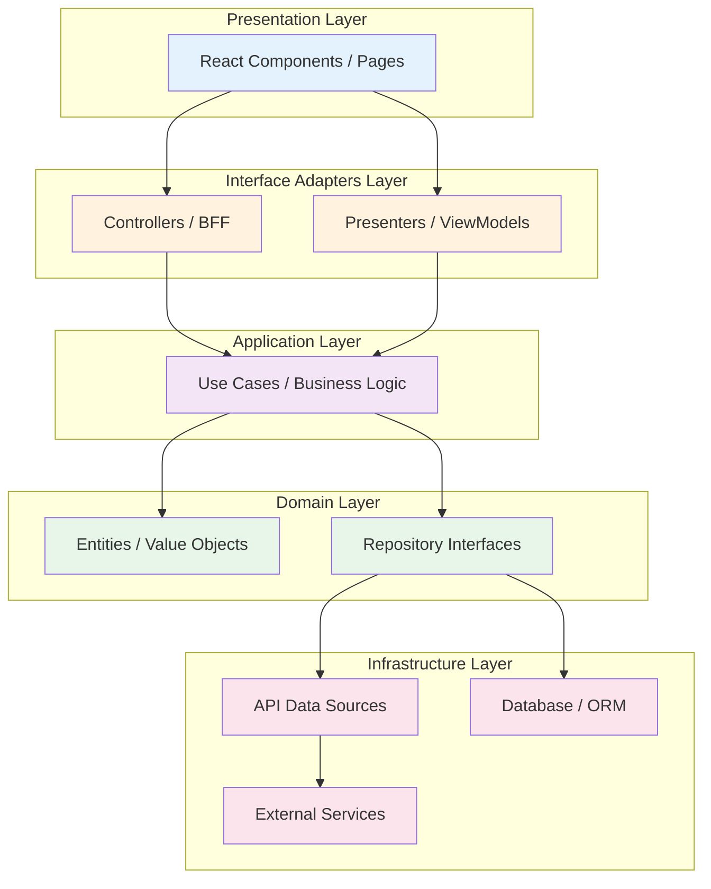
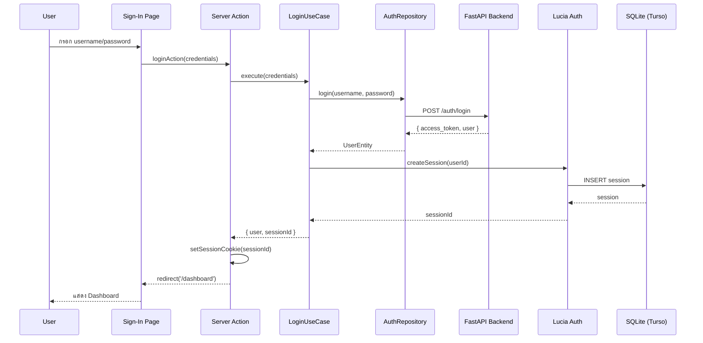
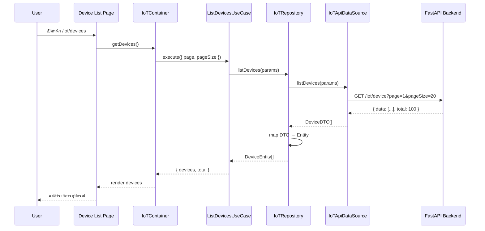
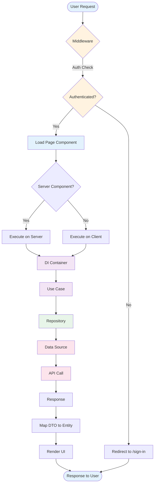

# เอกสารสถาปัตยกรรม React + Next.js + DDD
## IoT Monitoring Web Application

---

## บทนำ

เอกสารนี้อธิบายสถาปัตยกรรมของระบบ **IoT Monitoring Web Application** ที่พัฒนาด้วย **React 18 + Next.js 14** โดยใช้หลักการ **Domain-Driven Design (DDD)** และ **Clean Architecture**

โปรเจกต์นี้เป็นการ migrate จาก Angular 21 มาเป็น React/Next.js โดยรักษาโครงสร้างแบบ Clean Architecture และเพิ่มประสิทธิภาพด้วย Server Components, Server Actions และ App Router ของ Next.js

### วัตถุประสงค์

1. **แยกชั้นการทำงาน (Separation of Concerns)**: แยก Business Logic, UI, และ Infrastructure ออกจากกันอย่างชัดเจน
2. **ทดสอบง่าย (Testability)**: สามารถเขียน Unit Test และ E2E Test ได้ครอบคลุม
3. **บำรุงรักษาง่าย (Maintainability)**: โค้ดมีโครงสร้างชัดเจน ค้นหาและแก้ไขได้รวดเร็ว
4. **ขยายตัวได้ (Scalability)**: เพิ่ม Feature ใหม่ได้โดยไม่กระทบระบบเดิม
5. **ยืดหยุ่น (Flexibility)**: สลับ Database, API Backend หรือ UI Framework ได้ง่าย

### กลุ่มเป้าหมาย

เอกสารนี้เหมาะสำหรับ:
- **Full-stack Developers** ที่ต้องการทำความเข้าใจโครงสร้างโปรเจกต์
- **Frontend Developers** ที่จะพัฒนา UI และ Feature ใหม่
- **Backend Developers** ที่ต้องเชื่อมต่อ API กับ Frontend
- **DevOps Engineers** ที่ต้อง deploy และ maintain ระบบ
- **Architects** ที่ต้องการศึกษาหรือปรับปรุงสถาปัตยกรรม

### ความรู้พื้นฐานที่ต้องมี

- TypeScript, React Hooks, Next.js App Router
- Clean Architecture, DDD, Dependency Injection
- RESTful API, HTTP Client (fetch)
- Zod (Schema Validation)
- Git, Docker

---

## นิยามศัพท์ (Glossary)

| ศัพท์ | ความหมาย |
|------|----------|
| **Clean Architecture** | สถาปัตยกรรมที่แยกชั้นการทำงานตามหลัก Dependency Rule (ชั้นในไม่รู้จักชั้นนอก) |
| **DDD (Domain-Driven Design)** | แนวทางออกแบบซอฟต์แวร์ที่มุ่งเน้นที่ Business Domain เป็นหลัก |
| **Entity** | โมเดลข้อมูลหลัก (Domain Model) ที่มี identity เช่น User, Customer, Device |
| **Use Case** | กรณีการใช้งานเฉพาะ (Business Logic) เช่น CreateCustomer, GetDevice |
| **Repository** | Interface สำหรับการเข้าถึงข้อมูล (Data Access Layer) |
| **Data Source** | ตัวเชื่อมต่อกับแหล่งข้อมูลจริง เช่น REST API, Database |
| **DTO (Data Transfer Object)** | โครงสร้างข้อมูลที่ใช้ส่งต่อระหว่างชั้น |
| **DI (Dependency Injection)** | รูปแบบการส่งมอบ dependencies ให้กับ class/function |
| **BFF (Backend for Frontend)** | Adapter Layer ระหว่าง Frontend และ Backend |
| **Server Component** | React Component ที่ทำงานฝั่ง Server (Next.js) |
| **Server Action** | Function ที่ทำงานฝั่ง Server และเรียกจาก Client Component |

---

## โครงสร้างโฟลเดอร์ (Folder Structure)

```
c:\github\react-nextjs-ddd
├── app/                              # Next.js App Router (Presentation Layer)
│   ├── (auth)/                       # Authentication Route Group
│   │   ├── sign-in/page.tsx          # Login Page
│   │   └── sign-up/page.tsx          # Register Page
│   ├── (dashboard)/                  # Dashboard Route Group (Protected)
│   │   ├── layout.tsx                # Dashboard Layout (Tabler UI)
│   │   ├── page.tsx                  # Dashboard Home
│   │   ├── customers/                # Customers Feature Pages
│   │   ├── iot/                      # IoT Feature Pages
│   │   ├── monitoring/               # Monitoring Feature Pages
│   │   └── settings/                 # Settings Feature Pages
│   ├── _components/                  # Shared UI Components
│   │   ├── auth/                     # Auth-related Components
│   │   ├── layout/                   # Layout Components (Tabler)
│   │   └── shared/                   # Common Components
│   ├── api/                          # API Routes (Proxy to Backend)
│   ├── globals.scss                  # Global Styles (Tabler + Tailwind)
│   ├── layout.tsx                    # Root Layout
│   ├── error.tsx                     # Error Boundary
│   ├── not-found.tsx                 # 404 Page
│   └── unauthorized/                 # 403 Unauthorized Page
│
├── src/                              # Source Code (Clean Architecture)
│   ├── core/                         # Core Infrastructure Layer
│   │   ├── auth/                     # Authentication (Lucia v3)
│   │   ├── config/                   # Configuration Files
│   │   ├── db/                       # Database (Drizzle ORM + Turso)
│   │   ├── errors/                   # Custom Error Classes
│   │   ├── http/                     # HTTP Client (fetch wrapper)
│   │   ├── middleware/               # Middleware (Rate Limit, CORS)
│   │   ├── services/                 # Shared Services
│   │   └── ui/                       # Shared UI Utilities
│   │
│   ├── features/                     # Feature Modules (Vertical Slice)
│   │   ├── auth/                     # Authentication Feature
│   │   │   ├── domain/               # Domain Layer
│   │   │   │   ├── entities/         # Entities (User, Session)
│   │   │   │   ├── repositories/     # Repository Interfaces
│   │   │   │   └── use-cases/        # Use Cases (login, logout, signup)
│   │   │   ├── data/                 # Data Layer (Infrastructure)
│   │   │   │   ├── datasources/      # API Data Sources
│   │   │   │   ├── dtos/             # DTOs (Data Transfer Objects)
│   │   │   │   └── repositories/     # Repository Implementations
│   │   │   ├── presentation/         # Presentation Layer
│   │   │   │   ├── pages/            # Page Components
│   │   │   │   ├── components/       # Feature-specific Components
│   │   │   │   └── hooks/            # Feature-specific Hooks
│   │   │   └── index.ts              # Feature Entry Point
│   │   │
│   │   ├── customers/                # Customers Feature (Example)
│   │   │   ├── domain/
│   │   │   │   ├── entities/customer.entity.ts
│   │   │   │   ├── repositories/customers.repository.ts
│   │   │   │   └── use-cases/
│   │   │   │       ├── create-customer.use-case.ts
│   │   │   │       ├── list-customers.use-case.ts
│   │   │   │       └── get-customer.use-case.ts
│   │   │   ├── data/
│   │   │   │   ├── datasources/customers.api.datasource.ts
│   │   │   │   ├── dtos/customer.dto.ts
│   │   │   │   └── repositories/customers.repository.impl.ts
│   │   │   ├── presentation/
│   │   │   │   ├── pages/customer-list.tsx
│   │   │   │   └── components/customer-form.tsx
│   │   │   └── index.ts
│   │   │
│   │   ├── iot/                      # IoT Feature
│   │   │   ├── domain/
│   │   │   │   ├── entities/device.entity.ts
│   │   │   │   ├── repositories/iot.repository.ts
│   │   │   │   └── use-cases/iot.use-cases.ts
│   │   │   ├── data/
│   │   │   │   ├── datasources/iot.api.datasource.ts
│   │   │   │   ├── dtos/iot.dto.ts
│   │   │   │   └── repositories/iot.repository.impl.ts
│   │   │   ├── presentation/
│   │   │   │   ├── pages/
│   │   │   │   │   ├── device-list.tsx
│   │   │   │   │   ├── device-detail.tsx
│   │   │   │   │   ├── device-map.tsx
│   │   │   │   │   ├── iot-reports.tsx
│   │   │   │   │   └── iot-settings.tsx
│   │   │   │   └── iot.container.ts
│   │   │   └── index.ts
│   │   │
│   │   ├── monitoring/               # Monitoring Feature
│   │   ├── settings/                 # Settings Feature
│   │   └── errors/                   # Error Handling Feature
│   │
│   └── di/                           # Dependency Injection Container
│       ├── container.ts              # IoC Container (@evyweb/ioctopus)
│       └── types.ts                  # DI Types/Tokens
│
├── public/                           # Static Assets
│   ├── i18n/                         # i18n JSON Files (10 languages)
│   │   ├── en.json
│   │   ├── th.json
│   │   ├── ja.json
│   │   └── ...
│   └── images/
│
├── docs/                             # Documentation
│   ├── architecture-react-nextjs-ddd.md
│   ├── architecture-guide.md
│   ├── plan.md
│   ├── apiflow.md
│   └── Book/
│       └── 10-Book-AI-Assisted-Development.md
│
├── tests/                            # Tests
│   ├── unit/                         # Unit Tests (Vitest)
│   ├── integration/                  # Integration Tests
│   └── e2e/                          # E2E Tests (Playwright)
│
├── node_modules/@tabler/core/        # Tabler UI (SCSS)
├── middleware.ts                     # Next.js Middleware (Auth, i18n)
├── next.config.mjs                   # Next.js Configuration
├── tsconfig.json                     # TypeScript Configuration
├── vitest.config.ts                  # Vitest Configuration
├── playwright.config.ts              # Playwright Configuration
├── package.json
├── .env                              # Environment Variables
└── README.md
```

---

## หลักการทำงาน (Concept)

### Clean Architecture Layers



**Dependency Rule**: ชั้นใน (Domain, Application) ไม่รู้จักชั้นนอก (Infrastructure, Interface Adapters, Presentation)

### Feature Module Structure

แต่ละ Feature Module มีโครงสร้างแบบ Vertical Slice:

```
features/iot/
├── domain/              # ชั้นใน - Business Logic (ไม่ depend ชั้นอื่น)
│   ├── entities/        # โมเดลข้อมูล
│   ├── repositories/    # Interface (ไม่มี implementation)
│   └── use-cases/       # Business Logic
├── data/                # ชั้นนอก - Infrastructure (implement Repository)
│   ├── datasources/     # เชื่อมต่อ API/DB
│   ├── dtos/            # DTO สำหรับ API
│   └── repositories/    # Repository Implementation
├── presentation/        # ชั้นนอก - UI
│   ├── pages/           # Page Components
│   ├── components/      # Feature-specific Components
│   └── hooks/           # Feature-specific Hooks
└── index.ts             # Entry Point (export public APIs)
```

---

## Workflow และ Dataflow

### 1. Authentication Flow



### 2. Data Fetching Flow (IoT Devices)



### 3. Request Lifecycle (ละเอียด)



**อธิบายแต่ละขั้นตอน:**

1. **User Request**: ผู้ใช้เข้าถึง URL เช่น `/iot/devices`
2. **Middleware**: Next.js Middleware ตรวจสอบ Authentication และ i18n
3. **Auth Check**: ตรวจสอบ Session Cookie (Lucia)
4. **Redirect**: ถ้าไม่ Login → Redirect ไปหน้า Sign-In
5. **Load Page**: โหลด Page Component (`app/(dashboard)/iot/devices/page.tsx`)
6. **Server Component Check**: ตรวจว่าเป็น Server Component หรือ Client Component
7. **Execute**: รัน Component (Server-side หรือ Client-side)
8. **DI Container**: เรียก Dependencies จาก IoC Container (`@evyweb/ioctopus`)
9. **Use Case**: รัน Business Logic (เช่น `ListDevicesUseCase`)
10. **Repository**: เรียก Repository Interface
11. **Data Source**: Repository เรียก Data Source (เช่น `IoTApiDataSource`)
12. **API Call**: Data Source เรียก Backend API (FastAPI)
13. **Response**: รับ Response (DTO)
14. **Map DTO to Entity**: แปลง DTO เป็น Domain Entity
15. **Render UI**: Component รับ Entity และ Render UI
16. **Response to User**: ส่ง HTML/JSON กลับไปให้ User

### 4. Feature Module Internal Flow

```
┌─────────────────────────────────────────────────────────────┐
│                     Feature Module                          │
└─────────────────────────────────────────────────────────────┘

  User Action
      │
      ▼
  ┌─────────────────┐
  │ Page Component  │  (presentation/pages/)
  └────────┬────────┘
           │ calls
           ▼
  ┌─────────────────┐
  │   Container     │  (DI Container)
  └────────┬────────┘
           │ resolves
           ▼
  ┌─────────────────┐
  │   Use Case      │  (domain/use-cases/)
  └────────┬────────┘
           │ depends on
           ▼
  ┌─────────────────┐
  │   Repository    │  (domain/repositories/ - Interface)
  │   Interface     │
  └────────┬────────┘
           │ implemented by
           ▼
  ┌─────────────────┐
  │   Repository    │  (data/repositories/ - Implementation)
  │ Implementation  │
  └────────┬────────┘
           │ uses
           ▼
  ┌─────────────────┐
  │   Data Source   │  (data/datasources/)
  └────────┬────────┘
           │ calls
           ▼
  ┌─────────────────┐
  │  External API   │  (FastAPI Backend)
  └─────────────────┘
           │
           ▼ returns DTO
  ┌─────────────────┐
  │      DTO        │  (data/dtos/)
  └────────┬────────┘
           │ mapped to
           ▼
  ┌─────────────────┐
  │     Entity      │  (domain/entities/)
  └────────┬────────┘
           │
           ▼
  ┌─────────────────┐
  │ Page Component  │  (Render UI)
  └─────────────────┘
```

---

## การติดตั้งและการใช้งาน

### Prerequisites

- **Node.js**: 18+ (แนะนำ 20+)
- **npm** หรือ **yarn** หรือ **pnpm**
- **Docker** (สำหรับ Backend)
- **Git**

### Installation

```bash
# Clone Repository
git clone https://github.com/your-org/react-nextjs-ddd.git
cd react-nextjs-ddd

# Install Dependencies
npm install

# Setup Environment Variables
cp .env.example .env

# Start Backend (FastAPI + PostgreSQL)
docker-compose up -d

# Start Development Server
npm run dev
```

### Environment Variables

```env
# .env
NEXT_PUBLIC_API_URL=http://localhost:8000
DATABASE_URL=libsql://local.db
DATABASE_AUTH_TOKEN=
NODE_ENV=development
```

### Running Development Server

```bash
# Development (http://localhost:3000)
npm run dev

# Build for Production
npm run build

# Start Production Server
npm start

# Run Tests
npm run test          # Unit Tests (Vitest)
npm run test:e2e      # E2E Tests (Playwright)
npm run lint          # ESLint
npm run type-check    # TypeScript Type Check
```

---

## คู่มือการทดสอบ (Testing Guide)

### Test Commands

```bash
# Unit Tests (Vitest)
npm run test                # รัน Unit Tests
npm run test:watch          # รัน Unit Tests (Watch Mode)
npm run test:coverage       # รัน Unit Tests + Coverage Report

# E2E Tests (Playwright)
npm run test:e2e            # รัน E2E Tests
npm run test:e2e:ui         # รัน E2E Tests (UI Mode)

# Architecture Boundary Tests
npm run test:boundaries     # ตรวจสอบ Import Boundaries (ESLint Boundaries)
```

### Architecture Boundary Testing

ใช้ `eslint-plugin-boundaries` ตรวจสอบว่าชั้นต่าง ๆ ไม่ละเมิด Dependency Rule:

```json
// .eslintrc.json
{
  "plugins": ["boundaries"],
  "settings": {
    "boundaries/elements": [
      { "type": "domain", "pattern": "src/*/domain/*" },
      { "type": "application", "pattern": "src/*/application/*" },
      { "type": "infrastructure", "pattern": "src/*/data/*" },
      { "type": "presentation", "pattern": "src/*/presentation/*" }
    ],
    "boundaries/rules": [
      {
        "from": "domain",
        "disallow": ["infrastructure", "presentation", "application"]
      },
      {
        "from": "application",
        "disallow": ["infrastructure", "presentation"]
      }
    ]
  }
}
```

**ตรวจสอบ:**
- ✅ Domain Layer ไม่ import จาก Infrastructure, Presentation, Application
- ✅ Application Layer ไม่ import จาก Infrastructure, Presentation
- ✅ Infrastructure, Presentation import จาก Domain ได้

### Check List Test

#### 1. Unit Tests Checklist

| Test Type | File Pattern | Coverage Target | ตรวจสอบ |
|-----------|--------------|-----------------|---------|
| Entity Tests | `*.entity.test.ts` | 100% | ✅ Validation, Business Rules |
| Use Case Tests | `*.use-case.test.ts` | ≥ 90% | ✅ Success, Error Cases, Edge Cases |
| Repository Tests | `*.repository.test.ts` | ≥ 80% | ✅ Mock Data Source, Return Entity |

**ตัวอย่าง Unit Test:**

```typescript
// tests/unit/features/iot/domain/use-cases/list-devices.use-case.test.ts
import { describe, it, expect, vi } from 'vitest';
import { listDevicesUseCase } from '@/features/iot/domain/use-cases/iot.use-cases';
import type { IIoTRepository } from '@/features/iot/domain/repositories/iot.repository';

describe('listDevicesUseCase', () => {
  it('should return devices from repository', async () => {
    // Arrange
    const mockRepository: IIoTRepository = {
      listDevices: vi.fn().mockResolvedValue({
        data: [
          { id: 1, device_name: 'Device 1', device_type: 'Type A' },
          { id: 2, device_name: 'Device 2', device_type: 'Type B' },
        ],
        total: 2,
      }),
    };

    const useCase = listDevicesUseCase(mockRepository);

    // Act
    const result = await useCase.execute({ page: 1, pageSize: 20 });

    // Assert
    expect(result.data).toHaveLength(2);
    expect(result.total).toBe(2);
    expect(mockRepository.listDevices).toHaveBeenCalledWith({ page: 1, pageSize: 20 });
  });

  it('should handle empty results', async () => {
    // Arrange
    const mockRepository: IIoTRepository = {
      listDevices: vi.fn().mockResolvedValue({ data: [], total: 0 }),
    };

    const useCase = listDevicesUseCase(mockRepository);

    // Act
    const result = await useCase.execute({ page: 1, pageSize: 20 });

    // Assert
    expect(result.data).toHaveLength(0);
    expect(result.total).toBe(0);
  });

  it('should throw error when repository fails', async () => {
    // Arrange
    const mockRepository: IIoTRepository = {
      listDevices: vi.fn().mockRejectedValue(new Error('API Error')),
    };

    const useCase = listDevicesUseCase(mockRepository);

    // Act & Assert
    await expect(useCase.execute({ page: 1, pageSize: 20 })).rejects.toThrow('API Error');
  });
});
```

#### 2. Integration Tests Checklist

| Test Type | Scope | ตรวจสอบ |
|-----------|-------|---------|
| API Integration | Data Source → Backend API | ✅ Request/Response ถูกต้อง |
| DI Container | Container → Resolve Dependencies | ✅ Dependencies ถูกต้อง |
| Repository → Data Source | Repository → Data Source → DTO → Entity | ✅ Mapping ถูกต้อง |

#### 3. E2E Tests Checklist

| Test Scenario | Page | ตรวจสอบ |
|---------------|------|---------|
| Login Flow | `/sign-in` | ✅ Login สำเร็จ → Redirect `/dashboard` |
| Device List | `/iot/devices` | ✅ แสดงรายการอุปกรณ์ |
| Device Detail | `/iot/devices/[id]` | ✅ แสดงรายละเอียดอุปกรณ์ |
| Device Map | `/iot/map` | ✅ แสดงแผนที่อุปกรณ์ |
| Unauthorized Access | Protected Routes | ✅ Redirect to `/sign-in` ถ้าไม่ Login |

**ตัวอย่าง E2E Test:**

```typescript
// tests/e2e/auth.spec.ts
import { test, expect } from '@playwright/test';

test.describe('Authentication', () => {
  test('should login successfully', async ({ page }) => {
    // Navigate to login page
    await page.goto('/sign-in');

    // Fill credentials
    await page.fill('input[name="username"]', 'testuser');
    await page.fill('input[name="password"]', 'password123');

    // Click login button
    await page.click('button[type="submit"]');

    // Should redirect to dashboard
    await expect(page).toHaveURL('/dashboard');
    await expect(page.locator('h1')).toContainText('Dashboard');
  });

  test('should show error on invalid credentials', async ({ page }) => {
    await page.goto('/sign-in');

    await page.fill('input[name="username"]', 'invalid');
    await page.fill('input[name="password"]', 'wrongpassword');
    await page.click('button[type="submit"]');

    // Should show error message
    await expect(page.locator('.error-message')).toContainText('Invalid credentials');
  });

  test('should redirect to /sign-in when accessing protected route without auth', async ({ page }) => {
    // Try to access protected route
    await page.goto('/dashboard');

    // Should redirect to sign-in
    await expect(page).toHaveURL('/sign-in');
  });
});
```

---

## สรุป

### ประโยชน์ที่ได้รับ

1. **Testability สูง**: แยก Business Logic ออกจาก UI และ Infrastructure ทำให้เขียน Unit Test ได้ง่าย
2. **Maintainability**: โค้ดมีโครงสร้างชัดเจน ค้นหาและแก้ไขได้รวดเร็ว
3. **Flexibility**: สลับ Backend API, Database หรือ UI Framework ได้โดยไม่กระทบ Domain Layer
4. **Scalability**: เพิ่ม Feature ใหม่ได้โดยไม่กระทบระบบเดิม (Vertical Slice Architecture)
5. **Team Collaboration**: แยกงานได้ชัดเจน (Frontend, Backend, Domain Expert)
6. **Type Safety**: TypeScript + Zod ช่วยป้องกัน Runtime Error
7. **Performance**: Server Components + Server Actions ลด JavaScript ที่ส่งไปยัง Client

### ข้อควรระวัง

1. **Learning Curve สูง**: ต้องเรียนรู้ Clean Architecture, DDD, Dependency Injection
2. **Boilerplate Code**: มีโค้ดเยอะกว่าแบบธรรมดา (Entity, DTO, Repository, Use Case)
3. **Over-engineering**: Feature เล็ก ๆ อาจไม่จำเป็นต้องใช้ DDD
4. **Dependency Injection Setup**: ต้องตั้งค่า DI Container ให้ถูกต้อง
5. **Performance Overhead**: หลายชั้นอาจทำให้ช้าลงเล็กน้อย (แต่มีค่ากับความยืดหยุ่น)

### ข้อดี vs ข้อเสีย

| ข้อดี | ข้อเสีย |
|------|--------|
| ✅ Testable (Unit Test ได้ทุกชั้น) | ❌ Boilerplate Code เยอะ |
| ✅ Maintainable (โครงสร้างชัดเจน) | ❌ Learning Curve สูง |
| ✅ Flexible (สลับ Infrastructure ได้) | ❌ Over-engineering สำหรับ Feature เล็ก |
| ✅ Scalable (เพิ่ม Feature ไม่กระทบเดิม) | ❌ Dependency Injection ซับซ้อน |
| ✅ Type Safe (TypeScript + Zod) | ❌ Performance Overhead เล็กน้อย |
| ✅ Team Collaboration ง่าย | ❌ ต้องมี Discipline ในทีม |

### ข้อห้าม

1. **ห้าม** Domain Layer import จาก Infrastructure, Presentation (ละเมิด Dependency Rule)
2. **ห้าม** ใส่ Business Logic ใน Page Component (ต้องอยู่ใน Use Case)
3. **ห้าม** เรียก API โดยตรงจาก Component (ต้องผ่าน Repository → Data Source)
4. **ห้าม** ใช้ DTO ใน Domain Layer (ต้องใช้ Entity)
5. **ห้าม** Hardcode Configuration (ต้องใช้ Environment Variables)
6. **ห้าม** Skip Tests (ต้องมี Unit Test ≥ 80% Coverage)

### ตัวอย่างโค้ดที่รันได้จริง

#### Example 1: Create Customer Use Case

```typescript
// src/features/customers/domain/use-cases/create-customer.use-case.ts
import type { ICustomersRepository } from '../repositories/customers.repository';
import type { ICreateCustomerPresenter } from '../../presentation/presenters/create-customer.presenter';
import type { CustomerEntity } from '../entities/customer.entity';

export type CreateCustomerInputData = {
  name: string;
  email: string;
  phone?: string;
};

export type ICreateCustomerUseCase<VM> = {
  execute: (input: CreateCustomerInputData) => Promise<VM>;
};

export const createCustomerUseCase =
  <VM>(
    customersRepository: ICustomersRepository,
    presenter: ICreateCustomerPresenter<VM>
  ): ICreateCustomerUseCase<VM> =>
  async (input: CreateCustomerInputData): Promise<VM> => {
    try {
      // Validation
      if (!input.name || !input.email) {
        throw new Error('Name and email are required');
      }

      // Business Logic
      const customer: CustomerEntity = {
        id: 0, // Will be set by backend
        name: input.name,
        email: input.email,
        phone: input.phone,
        createdAt: new Date(),
        updatedAt: new Date(),
      };

      // Save via Repository
      const createdCustomer = await customersRepository.create(customer);

      // Present result
      return presenter.present(createdCustomer);
    } catch (error) {
      throw error;
    }
  };
```

#### Example 2: Customer Page Component (Server Component)

```typescript
// app/(dashboard)/customers/page.tsx
import { getInjection } from '@/di/container';
import type { IListCustomersBffController } from '@/features/customers/presentation/controllers/list-customers.controller';

export default async function CustomersPage() {
  // Resolve Controller from DI Container
  const controller = getInjection('IListCustomersBffController') as IListCustomersBffController;

  // Execute Use Case via Controller
  const viewModel = await controller.execute({ page: 1, pageSize: 20 });

  return (
    <div className="page-wrapper">
      <div className="page-header d-print-none">
        <h1 className="page-title">Customers</h1>
      </div>
      <div className="page-body">
        <div className="card">
          <div className="card-body">
            <table className="table">
              <thead>
                <tr>
                  <th>ID</th>
                  <th>Name</th>
                  <th>Email</th>
                  <th>Phone</th>
                </tr>
              </thead>
              <tbody>
                {viewModel.customers.map((customer) => (
                  <tr key={customer.id}>
                    <td>{customer.id}</td>
                    <td>{customer.name}</td>
                    <td>{customer.email}</td>
                    <td>{customer.phone}</td>
                  </tr>
                ))}
              </tbody>
            </table>
          </div>
        </div>
      </div>
    </div>
  );
}
```

#### Example 3: IoT Data Source Example

```typescript
// src/features/iot/data/datasources/iot.api.datasource.ts
import { createHttpClient } from '@/core/http/http-client';
import type { DeviceDTO, DeviceStatusDTO } from '../dtos/iot.dto';

export class IoTApiDataSource {
  private httpClient = createHttpClient();

  async listDevices(params?: {
    page?: number;
    pageSize?: number;
    keyword?: string;
  }): Promise<{ data: DeviceDTO[]; total: number }> {
    const searchParams = new URLSearchParams();
    if (params?.page) searchParams.set('page', params.page.toString());
    if (params?.pageSize) searchParams.set('pageSize', params.pageSize.toString());
    if (params?.keyword) searchParams.set('keyword', params.keyword);

    const response = await this.httpClient.get<{ data: DeviceDTO[]; total: number }>(
      `/iot/device?${searchParams.toString()}`
    );

    return response;
  }

  async getDeviceStatus(deviceId: number): Promise<DeviceStatusDTO> {
    const response = await this.httpClient.get<DeviceStatusDTO>(
      `/iot/devicestatus?deviceId=${deviceId}`
    );
    return response;
  }

  async getDeviceById(deviceId: number): Promise<DeviceDTO> {
    const response = await this.httpClient.get<DeviceDTO>(`/iot/device/${deviceId}`);
    return response;
  }
}
```

---

## Technology Stack

| Category | Technology | Version | Purpose |
|----------|-----------|---------|---------|
| **Frontend** | React | 18.3.1 | UI Library |
| | Next.js | 14.2.5 | Framework (App Router) |
| | TypeScript | 5.5.4 | Type Safety |
| **UI Framework** | Tabler UI | 1.0.0-beta21 | CSS Framework (SCSS) |
| | Tailwind CSS | 3.4.9 | Utility-first CSS |
| | shadcn/ui | Latest | Component Library |
| | Lucide React | 0.462.0 | Icons |
| **State Management** | React Server Components | - | Server-side State |
| | Server Actions | - | Server-side Mutations |
| **DI Container** | @evyweb/ioctopus | 2.1.3 | Dependency Injection |
| **Validation** | Zod | 3.23.8 | Schema Validation |
| **HTTP Client** | fetch (native) | - | API Calls |
| **Authentication** | Lucia | 3.2.1 | Cookie-based Auth |
| **Database** | Drizzle ORM | 0.36.1 | ORM |
| | Turso (libSQL) | Latest | SQLite Database |
| **Testing** | Vitest | 2.1.5 | Unit Tests |
| | Playwright | 1.49.0 | E2E Tests |
| | Testing Library | Latest | Component Tests |
| **i18n** | next-i18next | - | 10 languages |
| **Backend** | FastAPI | Latest | Python API |
| | PostgreSQL | 15 | Database |
| **DevOps** | Docker | Latest | Containerization |
| | Docker Compose | Latest | Multi-container |
| **Linting** | ESLint | 9 | Linting |
| | eslint-plugin-boundaries | Latest | Architecture Boundaries |

---

# ภาคผนวก A: AI-Assisted Development (tb-* Skills) สำหรับทีมพัฒนา

> **อ้างอิง:** จาก เล่ม 10 (ฉบับขยาย): คู่มือ AI-Assisted Development (tb-* Skills)
>
> **ผู้แต่ง:** kongnakorn jantakun
> **อีเมล:** kongnakornjantakun@gmail.com

---

## A.1 บทนำและปรัชญา AI-Assisted Development

### A.1.1 ทำไมต้อง AI-Assisted Development?

```
┌─────────────────────────────────────────────────────────────┐
│              PROBLEM vs SOLUTION                            │
└─────────────────────────────────────────────────────────────┘

  ปัญหาของการพัฒนาแบบเดิม:
  • เข้าใจ Task ผิด → Rework สูง
  • ไม่มี Plan → Implement วกวน
  • ไม่มี Safety Net → บั๊กหลุดถึง Prod
  • Context หาย → AI ตอบผิด

  Solution: Structured AI Workflow
  • Brainstorm ก่อน → ลด Misunderstanding
  • Plan ก่อน → ลด Rework
  • Scrutinize ก่อน Merge → ลด Defect
  • Context ชัด → AI ตอบตรง
```

### A.1.2 ปรัชญา 3 ข้อ

| หลักการ | ความหมาย | ผลลัพธ์ |
|---------|----------|---------|
| **Think Before Code** | เข้าใจก่อนลงมือ | ลด Rework |
| **Plan Before Execute** | วางแผนก่อนทำ | ลดการวกวน |
| **Verify Before Merge** | ตรวจสอบก่อนรวม | ลด Defect |

### A.1.3 AI เป็น "Pair Programmer" ไม่ใช่ "Auto-Coder"

```
❌ ผิด: Developer → AI → Code → Merge
   (AI ทำงานแทนทั้งหมด)

✅ ถูก: Developer ↔ AI (Brainstorm) → Plan → Execute → Scrutinize → Merge
   (AI เป็นคู่คิด, Developer เป็นผู้ตัดสินใจ)
```

**Developer ยังต้อง:**
- ตัดสินใจสุดท้าย (Final Decision)
- เข้าใจ Code ที่ AI สร้าง
- รับผิดชอบต่อ Code ที่ Merge
- Review ก่อน Commit

---

## A.2 tb-* Skills Overview

### A.2.1 แผนผัง Skills

```
┌─────────────────────────────────────────────────────────────┐
│                    tb-* SKILLS MAP                          │
└─────────────────────────────────────────────────────────────┘

  ┌──────────────────────────────────────────────────────┐
  │                  UNDERSTANDING PHASE                 │
  │  /tb-brainstorming  ──►  ทำความเข้าใจ · หา Assumption │
  └──────────────────────┬───────────────────────────────┘
                         │
                         ▼
  ┌──────────────────────────────────────────────────────┐
  │                  PLANNING PHASE                      │
  │  /tb-writing-plans  ──►  แบ่ง Subtask · Decision Log  │
  └──────────────────────┬───────────────────────────────┘
                         │
                         ▼
  ┌──────────────────────────────────────────────────────┐
  │                  EXECUTION PHASE                     │
  │  /tb-executing-plans  ──►  Implement + Test          │
  │  /tb-test-driven-development  ──►  Fix + Test        │
  └──────────────────────┬───────────────────────────────┘
                         │
                         ▼
  ┌──────────────────────────────────────────────────────┐
  │                  VERIFICATION PHASE                  │
  │  /tb-scrutinize  ──►  Logic + Side Effects (GATE)    │
  └──────────────────────┬───────────────────────────────┘
                         │
                         ▼
  ┌──────────────────────────────────────────────────────┐
  │                  DEBUGGING PHASE                     │
  │  /tb-investigate-error  ──►  Root Cause              │
  └──────────────────────────────────────────────────────┘
```

### A.2.2 ตาราง Skills (ละเอียด)

| Skill | เฟส | ใช้เมื่อ | Input | Output | เวลา |
|-------|-----|---------|-------|--------|------|
| `/tb-brainstorming` | Understanding | เริ่ม Task ใหม่ / ไม่ชัด | Task Description, Context | Assumptions, Questions, Scope | 5–15 นาที |
| `/tb-writing-plans` | Planning | ต้องวางแผน | Brainstorm Output | Subtasks, Decisions, Risks | 10–20 นาที |
| `/tb-executing-plans` | Execution | ลงมือ | Plan | Code + Tests | ตาม Task |
| `/tb-investigate-error` | Debugging | Bug / Error | Error Log, Reproduction | Root Cause, Fix Direction | 10–30 นาที |
| `/tb-test-driven-development` | Execution | แก้ Bug จุดเดียว | Bug Description | Test + Fix | 5–15 นาที |
| `/tb-scrutinize` | Verification | ก่อน Merge (บังคับ) | Code Diff, Context | Review Report, Issues | 5–10 นาที |

---

## A.3 Workflow Integration

### A.3.1 Normal Development Workflow

```
┌─────────────────────────────────────────────────────────────┐
│              NORMAL DEVELOPMENT WORKFLOW                    │
└─────────────────────────────────────────────────────────────┘

  Step 1: รับ Story Task จาก PO
         │
         ▼
  Step 2: /tb-brainstorming
         ├─ ระบุ Assumptions
         ├─ ถาม Questions
         └─ ยืนยัน Scope
         │
         ▼
  Step 3: /tb-writing-plans
         ├─ แบ่ง Subtasks
         ├─ Decision Log
         └─ Test Strategy
         │
         ▼
  Step 4: /tb-executing-plans (ทีละ Subtask)
         ├─ Implement
         ├─ Test
         └─ Commit (Atomic)
         │
         ▼
  Step 5: /tb-scrutinize (MANDATORY GATE)
         ├─ ผ่าน → Step 6
         └─ Fail → Fix → Step 5
         │
         ▼
  Step 6: PR + Code Review → Merge → Deploy
```

### A.3.2 Bug Fix Workflow

```
┌─────────────────────────────────────────────────────────────┐
│                   BUG FIX WORKFLOW                          │
└─────────────────────────────────────────────────────────────┘

  🔍 Step 1: /tb-investigate-error (เริ่มเสมอ)
         │
         ├─ Path A: แก้หลายจุด
         │   │
         │   ▼
         │   /tb-writing-plans → /tb-executing-plans
         │
         └─ Path B: แก้จุดเดียว
             │
             ▼
             /tb-test-driven-development
         │
         ▼
  🛡 Step 2: /tb-scrutinize (MANDATORY GATE)
         ├─ ผ่าน → Merge
         └─ Fail → Fix → Scrutinize
         │
         ▼
  📝 Step 3: เพิ่ม Regression Test
         │
         ▼
  🔄 Step 4: Merge → Deploy
```

---

## A.4 การนำ tb-* Skills มาใช้กับโปรเจกต์นี้

### A.4.1 ตัวอย่าง: เพิ่ม IoT Device Feature

**Step 1: Brainstorming**

```markdown
/tb-brainstorming

Task: เพิ่ม API POST /iot/devices สำหรับลงทะเบียนอุปกรณ์ IoT ใหม่

Context:
- Repo: react-nextjs-ddd
- Stack: React 18, Next.js 14, TypeScript, FastAPI (Backend)
- Model: Device (id, device_name, device_type, location_id, status)
- Constraint: device_name ต้องไม่ซ้ำ, location_id ต้องมีอยู่จริง

Expected Output:
- Assumptions ที่ต้องยืนยัน
- Scope (In/Out)
- Questions สำหรับ PO/BA
- Potential Risks
```

**Step 2: Writing Plans**

```markdown
/tb-writing-plans

Brainstorm Output: [แนบผลจาก Step 1]

Expected Output:
- Subtasks:
  1. สร้าง Entity (src/features/iot/domain/entities/device.entity.ts)
  2. สร้าง Repository Interface
  3. สร้าง Use Cases (CreateDevice, GetDevice, ListDevices)
  4. สร้าง Data Source (IoTApiDataSource)
  5. สร้าง React Page Component
  6. เขียน Tests
- Decision Log
- Test Strategy
- Definition of Done
```

**Step 3: Executing Plans**

```markdown
/tb-executing-plans

Plan: [แนบ Plan จาก Step 2]

Current Subtask: Subtask 1 - สร้าง Entity

Context Files:
- src/features/iot/domain/entities/device.entity.ts
- src/features/iot/domain/repositories/iot.repository.ts

Constraints:
- ต้องใช้ Zod สำหรับ Validation
- ต้องมี TypeScript Type Safety
- ต้องมี Unit Test
```

**Step 4: Scrutinize**

```markdown
/tb-scrutinize

Code Changes: [แนบ Diff]

Context:
- Task: เพิ่ม POST /iot/devices
- Related Files: device.entity.ts, iot.repository.ts, device-list.tsx
- Business Rules: device_name unique, location_id exists

Checklist:
1. Logic ถูกต้อง?
2. Edge Cases ครบ?
3. Security?
4. Performance?
5. Test Coverage?
```

### A.4.2 Integration กับ Git Workflow

```
main
 │
 ├── feature/IOT-101-add-device-registration
 │   │
 │   ├── /tb-brainstorming → (ไม่ Commit)
 │   ├── /tb-writing-plans → Commit (docs/plan-IOT-101.md)
 │   ├── /tb-executing-plans
 │   │   ├── Subtask 1 → Commit (feat: add device entity)
 │   │   ├── Subtask 2 → Commit (feat: add device repository)
 │   │   ├── Subtask 3 → Commit (feat: add device use cases)
 │   │   └── Subtask 4 → Commit (feat: add device page)
 │   ├── /tb-scrutinize → (ไม่ Commit — เป็น Gate)
 │   └── PR → Review → Merge
```

---

## A.5 Definition of Done (เพิ่มเติม)

การ Merge Code จะต้องผ่าน DoD ต่อไปนี้:

- [ ] Code ผ่าน Lint + Type Check
- [ ] Unit Test Coverage ≥ 80%
- [ ] Integration Test ผ่าน
- [ ] Code Review Approve ≥ 1
- [ ] CI Pipeline ผ่าน
- [ ] Documentation / API Contract อัปเดต
- [ ] Deploy บน Staging ได้
- [ ] Observability พร้อม (Log, Metric)
- [ ] ไม่มี Secrets ในโค้ด
- [ ] **ผ่าน /tb-scrutinize** ← **MANDATORY GATE**

---

## A.6 KPI สำหรับ AI-Assisted Development

| KPI | เป้าหมาย | วิธีวัด |
|-----|----------|---------|
| **Rework Rate** | < 10% | % งานที่ต้องแก้หลัง Merge |
| **Defect Leakage** | < 5% | % บั๊กที่หลุดถึง Prod |
| **Time to First PR** | ≤ 1 วัน | เวลาจากเริ่ม Task ถึง PR แรก |
| **Scrutinize Pass Rate** | ≥ 95% | % ที่ผ่าน Scrutinize ครั้งแรก |
| **Brainstorm Coverage** | 100% | % Task ที่ใช้ Brainstorm |
| **Plan Adherence** | ≥ 90% | % ที่ทำตาม Plan |
| **Test Coverage** | ≥ 80% | % Code ที่มี Test |
| **Developer Satisfaction** | ≥ 4/5 | ความพึงพอใจจาก Survey |

---

## A.7 Anti-Patterns (สิ่งที่ต้องหลีกเลี่ยง)

| # | Anti-Pattern | ผลกระทบ | วิธีแก้ |
|---|--------------|---------|--------|
| 1 | เริ่ม Execute ทันที | Rework สูง | Brainstorm ก่อน |
| 2 | ไม่มี Plan | วกวน | Plan ก่อน Execute |
| 3 | ข้าม Scrutinize | บั๊กหลุด | บังคับทุกครั้ง |
| 4 | Merge โดยไม่เข้าใจ | Maintain ไม่ได้ | ต้องเข้าใจทุกบรรทัด |
| 5 | ใช้ AI แทนคิด | ทีมไม่โต | AI เป็นคู่คิด ไม่ใช่แทน |
| 6 | ไม่ให้ Context | AI ตอบผิด | ให้ Context ครบ |
| 7 | Prompt กว้างเกิน | AI สับสน | แบ่ง Prompt เล็กลง |
| 8 | ไม่มี Test | Bug เยอะ | Test ทุก Subtask |
| 9 | Commit รวมใหญ่ | Review ยาก | Commit Atomic |
| 10 | ไม่บันทึก Decision | ลืมเหตุผล | Decision Log |

---

## A.8 Best Practices

### A.8.1 Do's (สิ่งที่ควรทำ)

- ✅ Brainstorm ก่อนทุก Task ใหม่
- ✅ Plan ก่อน Execute
- ✅ Scrutinize ก่อน Merge (บังคับ)
- ✅ Test ทุก Subtask
- ✅ Commit Atomic (ทีละ Subtask)
- ✅ บันทึก Decision Log
- ✅ อ่านและเข้าใจ Code ที่ AI สร้าง
- ✅ ให้ Context ครบ (Repo, Stack, Files, Patterns, Constraints)
- ✅ ใช้ AI เป็นคู่คิด ไม่ใช่ Auto-Coder
- ✅ วัดผลด้วย KPI

### A.8.2 Don'ts (สิ่งที่ไม่ควรทำ)

- ❌ ข้าม Scrutinize
- ❌ Merge โดยไม่เข้าใจ
- ❌ ใช้ AI กับ Production โดยตรง
- ❌ Commit Secrets
- ❌ ใช้ Library ที่ไม่ตรวจสอบ
- ❌ ปล่อยให้ AI ตัดสินใจสุดท้าย
- ❌ ทำ Task ใหญ่ในครั้งเดียว
- ❌ ไม่เขียน Test
- ❌ ไม่บันทึก Plan
- ❌ Over-engineered

---

## A.9 FAQ (คำถามที่พบบ่อย)

**Q1: ต้องใช้ทุก Skill ทุกครั้งไหม?**
A: ไม่ — Task เล็กมาก (แก้ Typo) ข้าม Brainstorm/Plan ได้ แต่ **Scrutinize บังคับทุกครั้ง**

**Q2: ถ้า AI ตอบช้า / ค้าง ทำไง?**
A: ลองแบ่ง Prompt ให้เล็กลง, ให้ Context น้อยลง, ลอง Skill ที่เล็กลง (เช่น TDD แทน Execute)

**Q3: AI สร้าง Code ที่ไม่เข้าใจ ทำไง?**
A: **ห้าม Merge** — ถาม AI ให้อธิบายทีละบรรทัด หรือให้เขียน Comment ถ้ายังไม่เข้าใจ → ปรึกษา Senior

**Q4: Scrutinize ผ่าน แต่ Code Review ไม่ผ่าน ทำไง?**
A: ใช้ Feedback จาก Code Review มา Improve — อาจต้องกลับไป Brainstorm/Plan ใหม่

**Q5: ใช้ AI กับ Legacy Code ได้ไหม?**
A: ได้ — แต่ต้องให้ Context เยอะขึ้น (Architecture, Pattern) และระวัง AI ไม่รู้ Context เก่า

**Q6: AI แนะนำ Library ที่ไม่รู้จัก ควรใช้ไหม?**
A: **อย่าเพิ่ง** — ตรวจ:
1. Library มีจริงไหม?
2. Maintain อยู่ไหม?
3. License OK ไหม?
4. Security (CVE) ไหม?
ถ้าไม่แน่ใจ → ปรึกษา Architect

**Q7: ต้อง Commit Plan ไหม?**
A: **แนะนำ** — Commit `docs/plan-{TICKET}.md` เพื่อเป็น Reference ในอนาคต

**Q8: ใช้ AI กับ Production โดยตรงได้ไหม?**
A: **ไม่ได้** — ต้องผ่าน Branch → PR → Review → Merge → Deploy ตามปกติ

---

## A.10 สรุปสาระสำคัญ (Key Takeaways)

```text
┌─────────────────────────────────────────────────────────────┐
│              AI-ASSISTED DEVELOPMENT                        │
│                     KEY TAKEAWAYS                           │
└─────────────────────────────────────────────────────────────┘

  1. AI เป็นคู่คิด ไม่ใช่ Auto-Coder — Developer ตัดสินใจสุดท้าย
  2. Brainstorm ก่อนทุก Task — ลด Misunderstanding
  3. Plan ก่อน Execute — ลด Rework
  4. Execute ทีละ Subtask + Test — ลด Bug
  5. Scrutinize ก่อน Merge — บังคับทุกครั้ง
  6. Investigate ก่อน Fix Bug — หา Root Cause
  7. TDD สำหรับ Bug จุดเดียว — Red → Green → Refactor
  8. Context ครบ — AI ตอบตรง
  9. Fallback เมื่อ AI ผิด — ระบุ, เพิ่ม Context, ลองใหม่
  10. วัดผลด้วย KPI — Rework, Defect, Time to First PR
  11. Git Workflow — Commit Atomic, PR Template
  12. อย่า Merge โดยไม่เข้าใจ — ต้องเข้าใจทุกบรรทัด
```

---

## A.11 Daily Checklist สำหรับ Developer

### ก่อนเริ่มงาน
- [ ] อ่าน Story + AC ครบ
- [ ] ผ่าน `/tb-brainstorming`
- [ ] มี Plan / Subtask
- [ ] สร้าง Branch ถูกต้อง

### ระหว่างพัฒนา
- [ ] เขียน Test ควบคู่
- [ ] รัน Lint + Type Check
- [ ] ไม่ Commit Secrets
- [ ] อัปเดต API Contract

### ก่อนเปิด PR
- [ ] Test ผ่านทั้งหมด
- [ ] Coverage ≥ 80%
- [ ] ผ่าน `/tb-scrutinize`
- [ ] แนบ Test Evidence
- [ ] มี Rollback Plan

### หลัง Merge
- [ ] Deploy Staging สำเร็จ
- [ ] Monitor Log/Metric
- [ ] แจ้ง QA / PO
- [ ] อัปเดต Documentation

---

**จบภาคผนวก A: AI-Assisted Development (tb-* Skills)**

> หมายเหตุ: ภาคผนวกนี้เป็น **Living Document** ควรทบทวนและปรับปรุงตามการเปลี่ยนแปลงของ Workflow และ Best Practices ของทีม

---

## เอกสารอ้างอิง

| ไฟล์ | รายละเอียด |
|------|-----------|
| [README.md](../README.md) | ภาพรวมโปรเจกต์, Setup, คำสั่งพื้นฐาน |
| [architecture-guide.md](./architecture-guide.md) | คู่มือการพัฒนาและบำรุงรักษา Clean Architecture |
| [module-map.md](./module-map.md) | Module dependency map, สรุป Features ทั้งหมด |
| [migration-report.md](./migration-report.md) | รายงาน migration จาก Angular 21 → React/Next.js |
| [theme-guide.md](./theme-guide.md) | คู่มือ Tabler UI + Tailwind + Dark Mode |
| [plan.md](./plan.md) | แผนการ migrate Features (Phase 0-8) |
| [apiflow.md](./apiflow.md) | API Flow, Proxy Configuration, Authentication |
| **[Book/10-Book-AI-Assisted-Development.md](./Book/10-Book-AI-Assisted-Development.md)** | **เล่ม 10 ฉบับเต็ม: AI-Assisted Development** |

---

**Last Updated**: 21 พฤศจิกายน 2026
**Version**: 1.1.0
